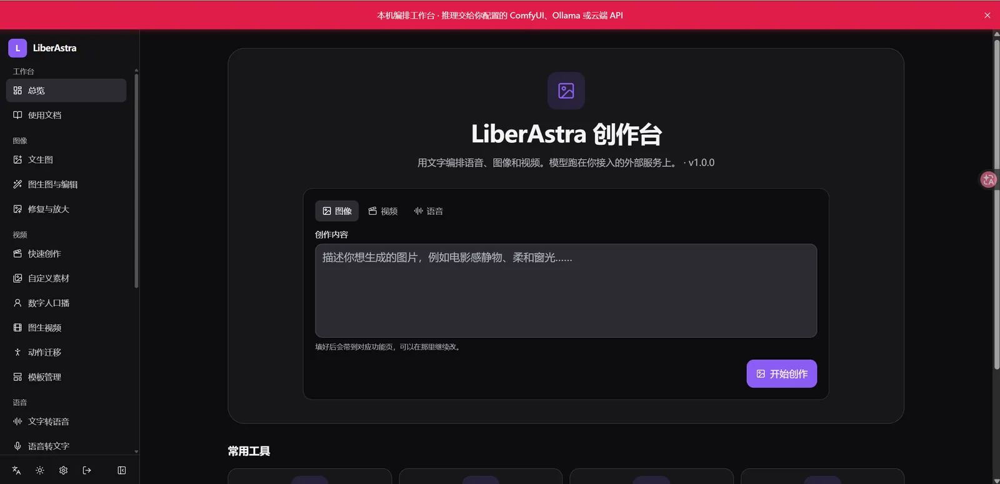
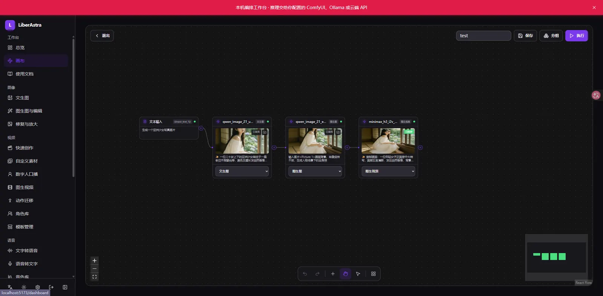
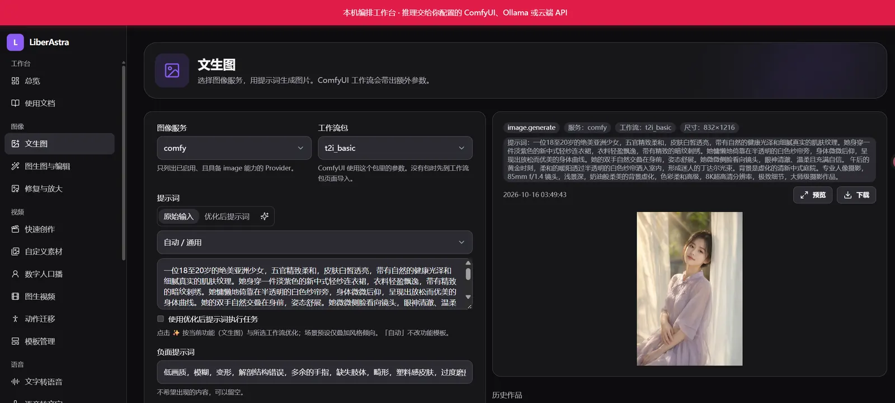
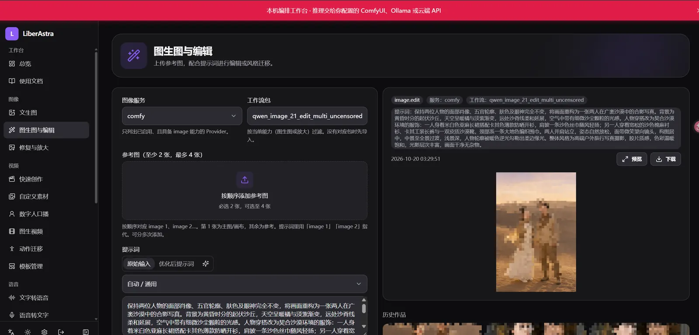
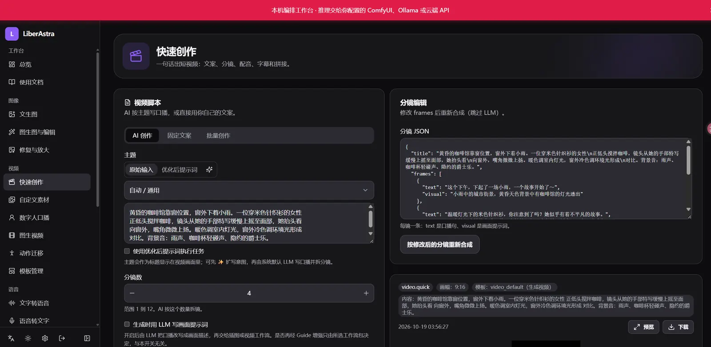
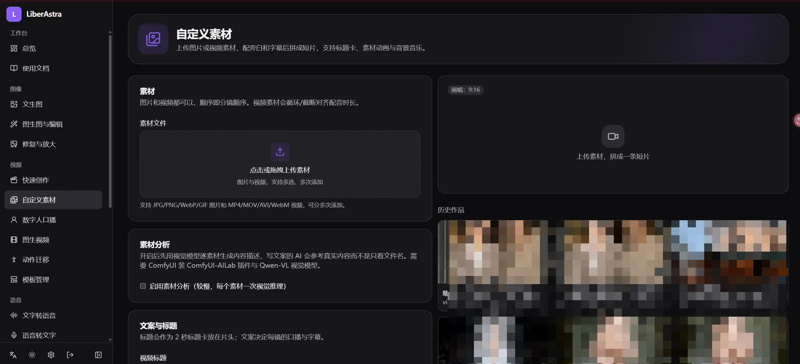
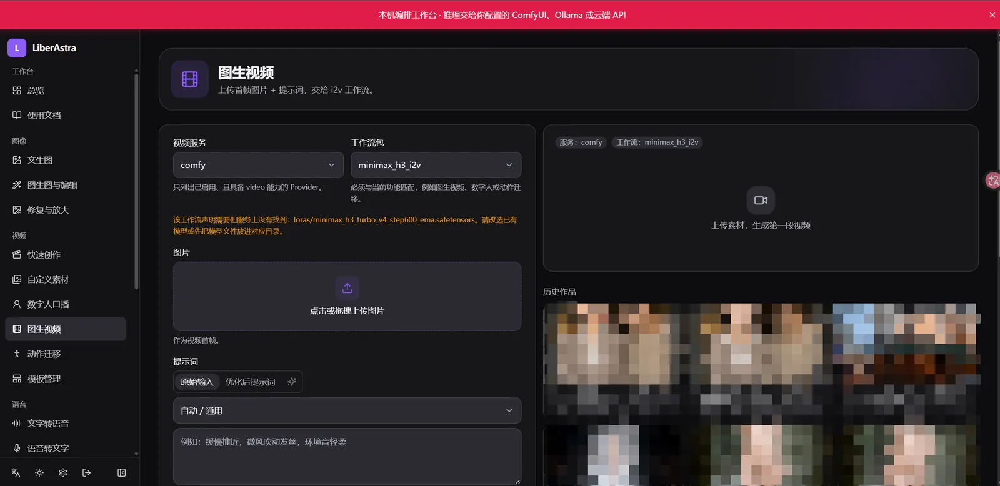
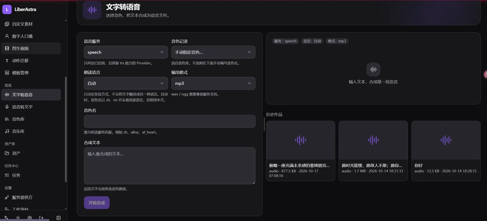

# LiberAstra

[中文](#中文) · [English](#english)

[](https://github.com/liberalchang/LiberAstra/releases)
[](LICENSE)
[](#快速开始)
[](https://github.com/liberalchang/LiberAstra/stargazers)

**LiberAstra 编排台 — self-hosted AIGC orchestration**

只编排、不推理：把 ComfyUI、Ollama 和语音接到同一个工作台（Web / CLI / MCP / OpenAI `/v1`）。

仓库：<https://github.com/liberalchang/LiberAstra>

搜索这个名字时，[liberastra.com.br](https://liberastra.com.br/) 是另一个项目。这里是开源的自托管 AIGC 编排台。

<a id="中文"></a>

## 你能用它做什么

- **一个工作台覆盖图、视频流水线和语音。** 出图、出声、出视频都交给已配置的外部服务。
- **编排和显卡可以分开放。** ComfyUI、Ollama、语音插件在本机或局域网另一台机器都行。
- **工作流包。** 导入 Comfy 图；内置图像和视频包，也支持你自己的包。
- **无限画布。** 把输入、工作流、语音和合成连成可执行流程。
- **四种入口。** Web（中英文、明暗主题）、`astra` CLI、MCP、OpenAI 兼容 `/v1`。
- **两条安装路径。** `docker compose`，或 Windows 安装包。

需要自备 ComfyUI、Ollama，或兼容的云端 API。LiberAstra 不替代它们，也不内置模型。

## 快速开始

在仓库根目录：

```bash
cp .env.example .env
docker compose up -d --build
```

浏览器打开 `http://localhost:8000`。首次创建管理员，再到「设置 → 服务提供方」填写各服务地址。

Windows：下载 [LiberAstra-Setup.exe](https://github.com/liberalchang/LiberAstra/releases/latest/download/LiberAstra-Setup.exe)，装完打开 `http://127.0.0.1:8000`。语音插件不在最新 Release 里，见下面的常见问题。

环境变量、分置和模型地址：[文档索引](docs/README.md)。

## 界面



功能演示（约 6 分钟）：

https://github.com/user-attachments/assets/7d134651-f796-43b1-8c5a-3a038228ca9d

## 和谁不同

下面只区分职责，没有速度或画质对比。

| | LiberAstra | ComfyUI | 典型聊天界面 |
| --- | --- | --- | --- |
| 角色 | 编排工作台 | 推理 / 工作流引擎 | 对话 |
| 模态 | 图、视频流水线、语音 | 偏图和视频图 | 偏文本 |
| 接入 | Web + CLI + MCP + `/v1` | 插件与自身 API | API / 插件 |
| 模型在哪跑 | 不跑，交给外部服务 | 在本机执行图 | 通常是云端或本地 LLM |

设计上参考过 Pixelle-Video、Dreamifly、Liber_SpeechAPI，边界见 [参考项目](#参考项目)。

## 常见问题

**要什么硬件？** 编排进程本身不需要 GPU。出图、出视频需要一台能跑 ComfyUI 的机器，可以在局域网另一台。只用在线 API 和 edge-tts 时，可以没有本地显卡。视频拼接需要 ffmpeg：容器镜像里已有；Windows 安装包需要系统里能找到 ffmpeg。

**模型文件放哪？** 放进 ComfyUI 的 `models\`，或用 Ollama 拉取。不要放进 LiberAstra 的数据目录。

**Docker 里访问本机的 ComfyUI / Ollama。** 用 `http://host.docker.internal:端口`。`localhost` 指容器自己。另一台机器用那台机器的局域网 IP。

**8000 端口被占用。** 在 `.env` 里设 `LIBERASTRA_PUBLISH_PORT=18000`，然后打开 `http://<主机>:18000`。容器内仍监听 8000。

**最新 Release 里没有 LiberSpeech-Setup.exe。** `v1.0.3` 只附带主程序。本地语音插件用 [v1.0.2 的 LiberSpeech-Setup.exe](https://github.com/liberalchang/LiberAstra/releases/download/v1.0.2/LiberSpeech-Setup.exe)。只做在线朗读时可以不装，用 edge-tts。

**装完页面是空的。** 先创建管理员，再添加服务提供方。没有 Provider 时，生成页没有可调用的后端。

## 文档

| 文档 | 内容 |
|------|------|
| [文档索引](docs/README.md) | 使用、部署、CLI、API |
| [部署（英文）](docs/deployment.en.md) | Docker、Windows、语音插件、模型放哪 |
| [在 Claude / Cursor 里用](docs/agents.md) | Skill 与 MCP |
| [参与贡献](CONTRIBUTING.md) | 怎么跑前端和后端、怎么提 PR |

<details>
<summary>功能说明</summary>

平台本身不做模型推理。界面按侧栏分组。各页和画布功能节点的提示词共用 **PromptField**（原始稿 / 优化稿、场景预设、提交优化任务，刷新后仍可接着看）。功能模板与场景预设在「设置 → 提示词模板」里改，保存后下一次优化即生效。

### 首页

工作台：按图像 / 视频 / 语音切换，写一句提示词即可进入对应功能。下方是常用入口。


### 画布

侧栏「工作台 → 画布」。在无限画布上把输入、工作流包、语音和合成连成流程图，按节点执行。

- **节点**：图片 / 视频 / 音频 / 文本输入，功能节点（按「所属」选一组工作流包），文字转语音 / 语音转文字，视频或音频合成。
- **分组**：功能节点的「所属」在「设置 → 工作流包 → 画布分组」里维护，也可按图像 / 视频 / 语音一键建默认组。选包后会按必填媒体自动补建输入节点。
- **执行**：选中节点则重跑选中项、上游未变则复用；未选中时确认后整张画布强制重跑。右侧可强制重跑当前节点及其上游。
- **结果**：功能、语音、合成节点的产物默认是中间结果，在预览上保存后进入资源库。资产页可勾选「含画布中间结果」查看未发布文件。输入节点上传的文件会直接进入资产库。
- **变量**：文本用 `{{变量名}}` 引用，`/` 可插入已连接节点；媒体标签如 `<Picture 1>` 原样交给工作流。图片输入可标记、涂蒙版、裁剪，并保留版本。



### 图像生成

- **文生图**：选图像服务与 `t2i` 工作流包。内置 Qwen-Image 2.1（官方 / 越狱）与传统 checkpoint 包。参数区可换 UNET、文本编码器、VAE；越狱包可开关 Uncensored LoRA。也支持在线图像 API。
- **图生图与编辑**：整图编辑只使用 1 张原图；多参考最多 4 张，用 `` `<image1>` `` / `` `<image2>` `` 把多人放进同一场景；局部重绘是原图加蒙版。官方包与越狱包成对。
- **修复与放大**：走 Upscale 模型，不是重新生图。





### 视频生成

- **快速创作**：AI 创作 / 固定文案 / 批量。口播拆成多镜，再按分镜模板出画面：静态排版、逐镜插图或逐镜文生视频，最后配音、字幕、BGM 拼接。是否用 LLM 写画面提示词由开关决定；工作流包里的 Guide 增强只跟所选包有关，两者互不关闭。包声明了 Turbo 时可开关加速 LoRA。
- **自定义素材**：已有图片或视频做成口播短片。可选素材分析、静图动画（`i2v`）、配音与 BGM。
- **数字人口播**：人物图 + 口播文案 → TTS → avatar 工作流（需自备并导入工作流包）。
- **图生视频**：首帧 + 提示词，走 `i2v`。内置 MiniMax H3 官方、越狱、越狱+提示词增强三套，可开 Turbo。
- **动作迁移**：参考视频 + 目标图（需自备 motion 工作流包）。
- **模板管理**：上传或覆盖分镜模板（`static_` / `image_` / `video_`）。







### 语音服务

- **文字转语音**：按服务类型切换控件。edge-tts、OpenAI 兼容 TTS、Liber Speech 音色库，或 Comfy `tts` 工作流。
- **语音转文字**：导出 txt / srt / vtt / json。
- **音色库**：登记可复用的克隆音色。
- **音乐库**：上传 BGM，供快速创作与自定义素材选用。



### 平台与接入

- **作品**、**任务**：生成结果与任务进度（SSE、取消 / 重试）。
- **设置**：服务提供方（地址与密钥）、工作流包导入与画布分组、提示词模板（功能模板 / 场景预设，可导入导出）、默认 LLM 与运行参数。
- **接入**：Web UI（中英文、明暗主题）、`astra` CLI、MCP Server、OpenAI 兼容 `/v1`（chat / audio / images）。单用户，API Token；Provider 密钥加密保存。

模型怎么配对、内置包名单见 [docs/使用文档.md](docs/使用文档.md)。

</details>

<details>
<summary>安装细节与模型下载</summary>

两种方式都只安装 **LiberAstra 编排程序**。Ollama、ComfyUI、语音插件是独立组件，装在本机或另一台主机均可。

更细的变量说明见 [docs/deployment.md](docs/deployment.md)，分置示例见 [docs/分置部署教程.md](docs/分置部署教程.md)。安装包、Ollama、ComfyUI 和各工作流模型的下载地址见 [部署相关资源下载](docs/Liberastra部署相关资源下载.md)。英文部署见 [docs/deployment.en.md](docs/deployment.en.md)。

### 容器里的可选 profile

只起 LiberAstra 时，Ollama / ComfyUI / 语音仍用已经装好的地址。需要把可选组件也放进同一套 Compose 时：

```bash
docker compose --profile ollama up -d      # 额外起 Ollama，宿主机 11434
docker compose --profile comfyui up -d     # 额外起 ComfyUI，宿主机 8188（需 NVIDIA Container Toolkit）
docker compose --profile speech up -d      # 额外起语音插件，宿主机 5555（需 NVIDIA）
docker compose --profile postgres up -d    # 额外起 PostgreSQL；同时设置 LIBERASTRA_DATABASE_URL
```

语音插件也可以只拷 `services/speech` 到显卡主机，在该目录执行 `docker compose up -d --build`。LiberAstra 里 Base URL 填 `http://<那台主机>:5555`。

常用参数（写在 `.env`，环境变量优先于该文件）：

| 参数 | 默认 | 作用 |
|------|------|------|
| `LIBERASTRA_PUBLISH_PORT` | `8000` | 宿主机对外端口。8000 被占用时改为 `18000` 等，容器内仍听 8000 |
| `LIBERASTRA_HOST` / `LIBERASTRA_PORT` | `0.0.0.0` / `8000` | 进程在容器内的监听地址，一般不用改 |
| `LIBERASTRA_DATA_DIR` | `./data`（容器内为 `/data`） | 数据库、作品、上传、用户工作流、日志 |
| `LIBERASTRA_SECRET_KEY` | 空则写入 `data/.secret_key` | JWT 与 Provider 密钥加密。换机器要连这个文件一起拷 |
| `LIBERASTRA_DATABASE_URL` | 空则 SQLite `data/liberastra.db` | 改用 PostgreSQL 时填写，并启用 `postgres` profile |
| `LIBER_SPEECH_DEVICE` | `auto` | 语音插件设备：`auto` / `cuda` / `cpu` |
| `LIBER_SPEECH_API_KEY` | 空 | 语音插件鉴权。LiberAstra 的 Provider 密钥填同一个值 |
| `LIBER_SPEECH_TTS_MODEL` | `multilingual` | 语音插件默认 TTS：`turbo` / `standard` / `multilingual` |
| `LIBER_SPEECH_ASR_MODEL` | `large-v3` | 语音插件默认识别模型 |

### Windows 安装包

从 [Releases](https://github.com/liberalchang/LiberAstra/releases) 下载 [LiberAstra-Setup.exe](https://github.com/liberalchang/LiberAstra/releases/latest/download/LiberAstra-Setup.exe)。安装包自带 Python 运行时和已构建的页面，目标电脑不用另装 Python 或 Node。数据在 `%LOCALAPPDATA%\LiberAstra\data`。安装程序会放行本机防火墙的 TCP 8000。

仓库里不提交安装包本体。需要自行重新打包时：

```powershell
powershell -ExecutionPolicy Bypass -File packaging\windows\build.ps1
```

产物：`packaging\windows\output\LiberAstra-Setup.exe`。构建机需要 Node.js 20+、外网，以及 [Inno Setup 6](https://jrsoftware.org/isdl.php)。视频成片还需要系统里能找到 [ffmpeg](https://www.gyan.dev/ffmpeg/builds/)（`winget install Gyan.FFmpeg`）。

**Ollama** 安装包：<https://ollama.com/download> ，默认 `http://<主机>:11434`。示例：

```bash
ollama pull orcarouter/Qwen3.8-27B-Uncensored:q4_K_M
ollama pull huihui_ai/gemma-4-abliterated:12b
```

已有 GGUF 时，在文件旁写 `Modelfile`（一行 `FROM ./模型文件.gguf`），再执行 `ollama create 本地模型名 -f Modelfile`。Windows 路径用正斜杠。

**ComfyUI** 桌面安装包：<https://www.comfy.org/download/> 。默认 `http://<主机>:8188`。权重放进 `models\`：

| 用途 | 下载 | 放到 |
|------|------|------|
| Qwen-Image 2.1 官方（UNET、8B 文本编码器、VAE） | <https://huggingface.co/Comfy-Org/Qwen-Image-2.1> | `diffusion_models/`、`text_encoders/`、`vae/` |
| Qwen-Image 2.1 可选 UNET `qwen-image-2.1-UC-int8_convrot.safetensors` | <https://huggingface.co/abenzerps/Qwen-Image-2.1-Uncensored-Quantized> | `diffusion_models/` |
| MiniMax H3 官方（主模型、文本编码器、视频/音频 VAE） | <https://huggingface.co/Comfy-Org/MiniMax-H3> | `diffusion_models/`、`text_encoders/`、`vae/` |
| H3 可选文本编码器（INT8，增强包用） | <https://huggingface.co/ethanfel/Qwen3-VL-32B-Ultra-Heretic-MiniMax-H3-ComfyUI-INT8-ConvRot> | `text_encoders/` |
| H3 可选文本编码器（NVFP4） | <https://huggingface.co/sakamakismile/Qwen3-VL-32B-Heretic-MiniMax-H3-NVFP4> | `text_encoders/` |
| H3 Turbo LoRA | <https://huggingface.co/larryvrh/MiniMax-H3-Turbo-Lora> 、<https://huggingface.co/lightx2v/Minimax-h3-Turbo> | `loras/` |

成套文件名见 [docs/使用文档.md](docs/使用文档.md)。

**语音插件（可选）。** 只做在线朗读时可以不装。需要本地合成或识别时：

- Windows： [v1.0.2 的 LiberSpeech-Setup.exe](https://github.com/liberalchang/LiberAstra/releases/download/v1.0.2/LiberSpeech-Setup.exe)。`v1.0.3` 未附带该文件。向导结束时会执行 `docker compose up -d --build`，并放行 TCP 5555。
- Linux 显卡主机：把 `LiberSpeech-plugin.zip` 拷过去，解压后执行 `sh install.sh`。该压缩包由 `packaging\speech\build.ps1` 生成，不随 Release 发布。

同一台机器的 Base URL 填 `http://127.0.0.1:5555`，别的主机填 `http://<IP>:5555`。

</details>

## 开发

本地前后端、测试和 PR 约定见 [CONTRIBUTING.md](CONTRIBUTING.md)。

```bash
cd backend && uv venv .venv && uv pip install -e ".[dev]"
uv run astra serve --reload

cd frontend && npm install && npm run dev
```

CLI 示例：

```bash
astra tts "你好" --voice zh-CN-XiaoxiaoNeural -o hello.mp3
astra image gen --prompt "一只橘猫" -o ./out
astra video quick --topic "三个提高效率的小技巧" --voice zh-CN-XiaoxiaoNeural -o v.mp4
astra mcp
```

## 仓库结构

- `backend/` — FastAPI 后端、`astra` CLI、MCP、Alembic 迁移、内置工作流包（`workflows/`）
- `frontend/` — React 19 + Vite + Tailwind v4 + i18next
- `docker/`、`docker-compose.yml` — 单镜像（ffmpeg + 中文字体）与可选 profile
- `packaging/windows/`、`packaging/speech/` — Windows 主程序与语音插件的构建脚本
- `skills/liberastra/` — Agent Skill
- `docs/` — 使用与部署；研发笔记在 `docs/internal/`
- `site/` — 一页落地，尚未发布到 GitHub Pages
- `.github/workflows/ci.yml` — lint、测试、前端构建、镜像构建

## 参考项目

LiberAstra 以重新实现为主。协议与移植范围见 [THIRD_PARTY_NOTICES.md](THIRD_PARTY_NOTICES.md)。

| 项目 | 原 GitHub | 协议 | 本仓库如何参考 |
|------|-----------|------|----------------|
| [Pixelle-Video](https://github.com/AIDC-AI/Pixelle-Video) | https://github.com/AIDC-AI/Pixelle-Video | Apache-2.0 | 视频流水线设计；分镜模板与素材分析工作流移植自其仓库 |
| [Dreamifly](https://github.com/LastLighter/Dreamifly) | https://github.com/LastLighter/Dreamifly | MIT | 图像能力与 ComfyUI 工作流模板映射的设计参考 |
| [Liber_SpeechAPI](https://github.com/liberalchang/Liber_SpeechAPI) | https://github.com/liberalchang/Liber_SpeechAPI | AGPL-3.0 | **仅参考接口形态**；本仓库 `services/speech` 为独立实现，不打包其源码 |

---

<a id="english"></a>

## English

**LiberAstra — self-hosted AIGC orchestration.** It connects ComfyUI, Ollama, and speech services to one desk: Web UI, `astra` CLI, MCP, and an OpenAI-compatible `/v1`. The app does not run models. MIT.

Repository: <https://github.com/liberalchang/LiberAstra>

[liberastra.com.br](https://liberastra.com.br/) is a different project. This repository is the open-source orchestration desk.

### What it is for

- One desk for images, a video pipeline, and speech. Inference stays on services you configure.
- The desk and the GPU can live on different machines.
- Workflow packs: import a Comfy graph. Official packs ship with the repo; you can add your own.
- An infinite canvas wires inputs, packs, speech, and concat into a runnable graph.
- Four clients: Web (Chinese and English, light and dark), CLI, MCP, OpenAI-compatible `/v1`.
- Docker Compose or a Windows installer.

You bring ComfyUI, Ollama, or a compatible API. LiberAstra does not replace them and does not bundle weights.

### Quick start

From the repository root:

```bash
cp .env.example .env
docker compose up -d --build
```

Open `http://localhost:8000`. Create the admin user, then Settings → Providers.

Windows: [LiberAstra-Setup.exe](https://github.com/liberalchang/LiberAstra/releases/latest/download/LiberAstra-Setup.exe), then `http://127.0.0.1:8000`. The speech installer is not on the latest release; see the FAQ.

Full steps, profiles, and model locations: [docs/deployment.en.md](docs/deployment.en.md). Index: [docs/README.md](docs/README.md).

### Interface


Feature walkthrough, about 6 minutes:

https://github.com/user-attachments/assets/7d134651-f796-43b1-8c5a-3a038228ca9d

### How it differs

Roles only. There is no speed or quality benchmark.

| | LiberAstra | ComfyUI | A typical chat UI |
| --- | --- | --- | --- |
| Role | Orchestration desk | Inference / graph engine | Conversation |
| Modalities | Image, video pipeline, speech | Mostly image and video graphs | Mostly text |
| Access | Web + CLI + MCP + `/v1` | Plugins and its own API | API / plugins |
| Where models run | Not here | On the ComfyUI host | Usually a cloud or local LLM |

Pixelle-Video, Dreamifly, and Liber_SpeechAPI are upstream references. See [Reference projects](#reference-projects).

### FAQ

**Hardware.** The orchestration process does not need a GPU. Image and video need a machine that can run ComfyUI, which can be another host on the LAN. Online APIs plus edge-tts need no local GPU. Video assembly needs ffmpeg (included in the Docker image; install it on Windows).

**Where weights go.** Into ComfyUI's `models\` directory, or pull them with Ollama. Not into LiberAstra's data directory.

**Docker reaching a service on the host.** Use `http://host.docker.internal:<port>`. `localhost` inside the container is the container. Another machine is that machine's LAN IP.

**Port 8000 is taken.** Set `LIBERASTRA_PUBLISH_PORT=18000` in `.env` and open `http://<host>:18000`.

**No LiberSpeech-Setup.exe on the latest release.** v1.0.3 ships the main app only. Use [LiberSpeech-Setup.exe from v1.0.2](https://github.com/liberalchang/LiberAstra/releases/download/v1.0.2/LiberSpeech-Setup.exe). edge-tts covers online read-aloud without the plugin.

**Empty generate pages.** Create the admin account, then add a provider. Without one there is no backend to call.

### Docs

[Deployment](docs/deployment.en.md) · [Docs index](docs/README.md) · [Claude / Cursor](docs/agents.md) · [Contributing](CONTRIBUTING.md)

<details>
<summary>Capabilities</summary>

Prompt fields share one control: raw and optimized drafts, scene presets, and an optimize action that survives refresh. Templates live under Settings → Prompt Templates.

**Home.** Pick image, video, or speech and start from one line.

**Canvas.** Workspace → Canvas. Connect inputs, workflow packs, speech, and concat, then run the graph. Groups are maintained under Settings → Workflow Packs. Unchanged upstream nodes are reused. Save a preview into the asset library when you want to keep it. Text references use `{{variable}}`; media tags such as `<Picture 1>` pass through to the workflow.


**Images.** Text-to-image, including Qwen-Image 2.1 packs and classic checkpoints, plus online image APIs. Edit: full frame, up to four references, or inpaint with a mask. Upscale uses an upscale model.


**Video.** Quick create turns a topic or a fixed script into a short: storyboard, per-shot stills or text-to-video, TTS, subtitles, and BGM. The LLM visual-prompt switch and a pack's Guide enhancer are independent. Also: custom assets, talking avatar (bring your own avatar pack), image-to-video on MiniMax H3 with an optional Turbo LoRA, motion transfer, and storyboard templates (`static_` / `image_` / `video_`).


**Speech.** edge-tts, OpenAI-compatible TTS, Liber Speech, or a Comfy TTS pack. Speech-to-text exports txt, srt, vtt, or json. Voice library and a music library for BGM.


**Platform.** Asset library, job queue with SSE, cancel and retry. Single user. Provider keys are encrypted. Clients: Web UI, `astra` CLI, MCP, OpenAI-compatible `/v1` (chat, audio, images).

The long pairing manual is Chinese: [docs/使用文档.md](docs/使用文档.md). The Web UI itself is bilingual.

</details>

### Reference projects

Re-implementation first. Licenses and what was ported: [THIRD_PARTY_NOTICES.md](THIRD_PARTY_NOTICES.md).

| Project | Original GitHub | License | How we use it |
| --- | --- | --- | --- |
| [Pixelle-Video](https://github.com/AIDC-AI/Pixelle-Video) | https://github.com/AIDC-AI/Pixelle-Video | Apache-2.0 | Video pipeline design; storyboard templates and analysis workflows ported |
| [Dreamifly](https://github.com/LastLighter/Dreamifly) | https://github.com/LastLighter/Dreamifly | MIT | Image UX and ComfyUI workflow-mapping design reference |
| [Liber_SpeechAPI](https://github.com/liberalchang/Liber_SpeechAPI) | https://github.com/liberalchang/Liber_SpeechAPI | AGPL-3.0 | **API shape only**; `services/speech` is an independent implementation |
