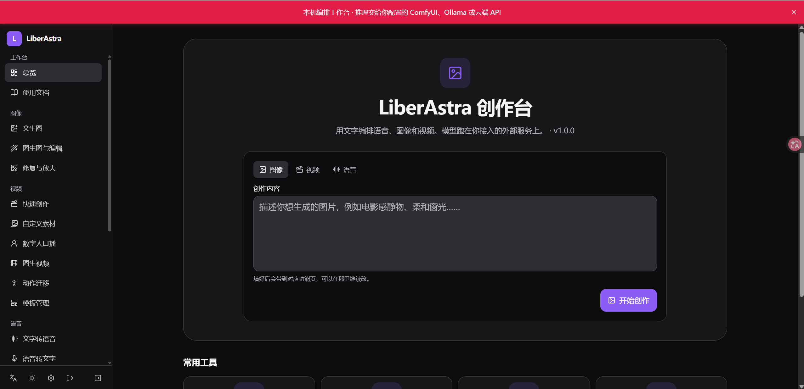
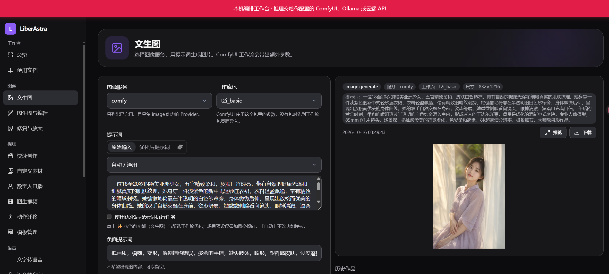
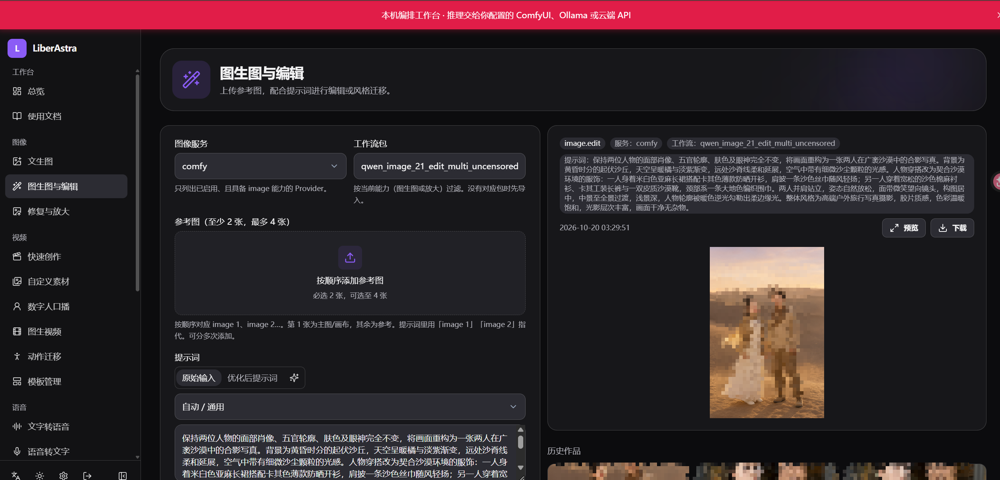
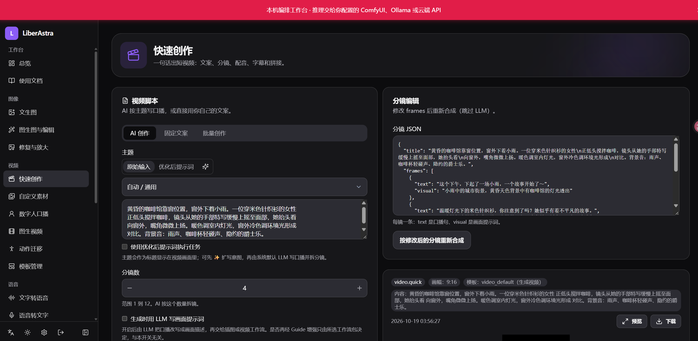
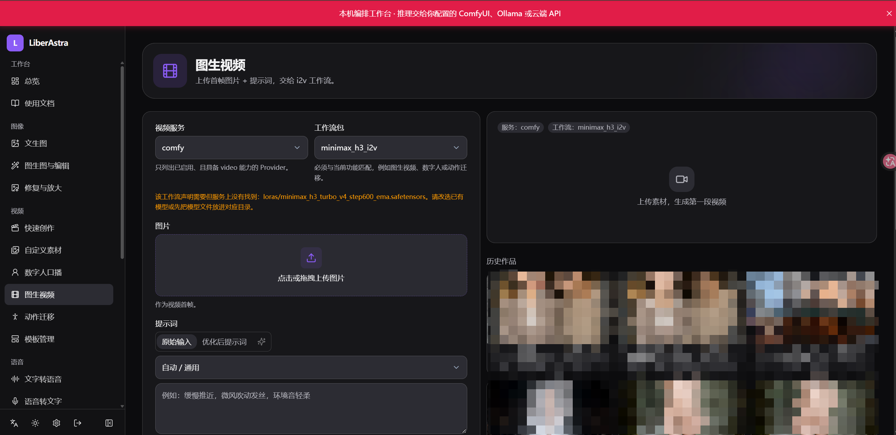
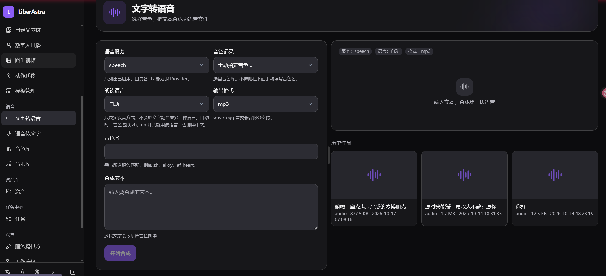

# LiberAstra

[English](#english) | 自托管 AIGC 聚合编排平台 · MIT

对接局域网或本地的 ComfyUI、Ollama、OpenAI 兼容服务，以及云端模型 API，提供语音、图像、视频三大能力。**平台本身不做模型推理**，只做编排。

## 功能

平台本身不做模型推理。界面按侧栏分组；出图、出声、出视频都交给已配置的外部服务。各页和画布功能节点的提示词共用 **PromptField**（原始稿 / 优化稿、场景预设、✨ 提交优化任务，刷新后仍可接着看）。功能模板与场景预设在「设置 → 提示词模板」里改，保存后下一次优化即生效。

### 首页

工作台：按图像 / 视频 / 语音切换，写一句提示词即可进入对应功能。下方是常用入口。



### 画布

侧栏「工作台 → 画布」。在无限画布上把输入、工作流包、语音和合成连成流程图，按节点执行。

- **节点**：图片 / 视频 / 音频 / 文本输入，功能节点（按「所属」选一组工作流包），文字转语音 / 语音转文字，视频或音频合成。
- **分组**：功能节点的「所属」在「设置 → 工作流包 → 画布分组」里维护，也可按图像 / 视频 / 语音一键建默认组。选包后会按必填媒体自动补建输入节点。
- **执行**：选中节点则重跑选中项、上游未变则复用；未选中时确认后整张画布强制重跑。右侧可强制重跑当前节点及其上游。
- **结果**：功能、语音、合成节点的产物默认是中间结果，在预览上保存后进入资源库。资产页可勾选「含画布中间结果」查看未发布文件。输入节点上传的文件会直接进入资产库。
- **变量**：文本用 `{{变量名}}` 引用，`/` 可插入已连接节点；媒体标签如 `<Picture 1>` 原样交给工作流。图片输入可标记、涂蒙版、裁剪，并保留版本。

### 图像生成

- **文生图**：选图像服务与 `t2i` 工作流包。内置 Qwen-Image 2.1（官方 / 越狱）与传统 checkpoint 包。参数区可换 UNET、文本编码器、VAE；越狱包可开关 Uncensored LoRA。也支持在线图像 API。
- **图生图与编辑**：整图编辑只使用 1 张原图；多参考最多 4 张，用 `` `<image1>` `` / `` `<image2>` `` 把多人放进同一场景；局部重绘是原图加蒙版。官方包与越狱包成对。
- **修复与放大**：走 Upscale 模型，不是重新生图。





### 视频生成

- **快速创作**：AI 创作 / 固定文案 / 批量。口播拆成多镜，再按分镜模板出画面：静态排版、逐镜插图或逐镜文生视频，最后配音、字幕、BGM 拼接。是否用 LLM 写画面提示词由开关决定；工作流包里的 Guide 增强只跟所选包有关，两者互不关闭。包声明了 Turbo 时可开关加速 LoRA。
- **自定义素材**：已有图片或视频做成口播短片。可选素材分析、静图动画（`i2v`）、配音与 BGM。
- **数字人口播**：人物图 + 口播文案 → TTS → avatar 工作流（需自备并导入工作流包）。
- **图生视频**：首帧 + 提示词，走 `i2v`。内置 MiniMax H3 官方、越狱、越狱+提示词增强三套，可开 Turbo。
- **动作迁移**：参考视频 + 目标图（需自备 motion 工作流包）。
- **模板管理**：上传或覆盖分镜模板（`static_` / `image_` / `video_`）。






### 语音服务

- **文字转语音**：按服务类型切换控件。edge-tts、OpenAI 兼容 TTS、Liber Speech 音色库，或 Comfy `tts` 工作流。
- **语音转文字**：导出 txt / srt / vtt / json。
- **音色库**：登记可复用的克隆音色。
- **音乐库**：上传 BGM，供快速创作与自定义素材选用。



### 平台与接入

- **作品**、**任务**：生成结果与任务进度（SSE、取消 / 重试）。
- **设置**：服务提供方（地址与密钥）、工作流包导入与画布分组、提示词模板（功能模板 / 场景预设，可导入导出）、默认 LLM 与运行参数。
- **接入**：Web UI（中英文、明暗主题）、`astra` CLI、MCP Server、OpenAI 兼容 `/v1`（chat / audio / images）。单用户，API Token；Provider 密钥加密保存。

模型怎么配对、内置包名单见 [docs/使用文档.md](docs/使用文档.md)。

## 安装部署

两种方式都只安装 **LiberAstra 编排程序**。Ollama、ComfyUI、语音插件是独立组件，装在本机或另一台主机均可。装好后打开页面，首次创建管理员，再到「设置 → 服务提供方」填各服务的地址。

更细的变量说明见 [docs/deployment.md](docs/deployment.md)，分置示例见 [docs/分置部署教程.md](docs/分置部署教程.md)。

### 方式 1：容器部署

在仓库根目录：

```bash
cp .env.example .env
docker compose up -d --build
```

默认访问 `http://<主机>:8000`，数据在 `./data`。

只起 LiberAstra 时，Ollama / ComfyUI / 语音仍用已经装好的地址（本机或局域网 IP）。需要把可选组件也放进同一套 Compose 时，加上 profile：

```bash
docker compose --profile ollama up -d      # 额外起 Ollama，宿主机 11434
docker compose --profile comfyui up -d     # 额外起 ComfyUI，宿主机 8188（需 NVIDIA Container Toolkit）
docker compose --profile speech up -d      # 额外起语音插件，宿主机 5555（需 NVIDIA）
docker compose --profile postgres up -d    # 额外起 PostgreSQL；同时设置 LIBERASTRA_DATABASE_URL

docker compose --profile ollama --profile comfyui up -d
```

语音插件也可以只拷 `services/speech` 到显卡主机，在该目录执行 `docker compose up -d --build`。LiberAstra 里 Base URL 填 `http://<那台主机>:5555`。

常用参数（写在 `.env`，环境变量优先于该文件）：

| 参数 | 默认 | 作用 |
|------|------|------|
| `LIBERASTRA_PUBLISH_PORT` | `8000` | 宿主机对外端口。8000 被占用时改为 `18000` 等，容器内仍听 8000 |
| `LIBERASTRA_HOST` / `LIBERASTRA_PORT` | `0.0.0.0` / `8000` | 进程在容器内的监听地址，一般不用改 |
| `LIBERASTRA_DATA_DIR` | `./data`（容器内为 `/data`） | 数据库、作品、上传、用户工作流、日志 |
| `LIBERASTRA_SECRET_KEY` | 空则写入 `data/.secret_key` | JWT 与 Provider 密钥加密。换机器要连这个文件一起拷 |
| `LIBERASTRA_DATABASE_URL` | 空则 SQLite `data/liberastra.db` | 改用 PostgreSQL 时填写，并启用 `postgres` profile |
| `LIBER_SPEECH_DEVICE` | `auto` | 语音插件设备：`auto` / `cuda` / `cpu` |
| `LIBER_SPEECH_API_KEY` | 空 | 语音插件鉴权。LiberAstra 的 Provider 密钥填同一个值 |
| `LIBER_SPEECH_TTS_MODEL` | `multilingual` | 语音插件默认 TTS：`turbo` / `standard` / `multilingual` |
| `LIBER_SPEECH_ASR_MODEL` | `large-v3` | 语音插件默认识别模型 |

容器访问**宿主机**上的 ComfyUI / Ollama 时，地址用 `http://host.docker.internal:端口`。访问**另一台机器**时用那台机器的局域网 IP。

### 方式 2：Windows 安装

主程序、Ollama、ComfyUI、语音插件分开安装。主程序不内置模型。

**LiberAstra 主程序（本机安装包）**

从 [Releases](https://github.com/liberalchang/LiberAstra/releases) 下载 [LiberAstra-Setup.exe](https://github.com/liberalchang/LiberAstra/releases/latest/download/LiberAstra-Setup.exe)。安装包自带 Python 运行时和已构建的页面，目标电脑不用另装 Python 或 Node。双击安装，按向导完成。完成后从开始菜单或桌面启动，浏览器打开 `http://127.0.0.1:8000`。数据在 `%LOCALAPPDATA%\LiberAstra\data`（账号、作品、密钥）。安装程序会放行本机防火墙的 TCP 8000，局域网里的浏览器可以用 `http://<这台电脑的 IP>:8000` 打开。

仓库里不提交安装包本体。需要自行重新打包时，在本机执行：

```powershell
powershell -ExecutionPolicy Bypass -File packaging\windows\build.ps1
```

产物：`packaging\windows\output\LiberAstra-Setup.exe`。构建机需要 Node.js 20+、外网，以及 [Inno Setup 6](https://jrsoftware.org/isdl.php)（脚本会尝试用 winget 安装）。视频成片还需要系统里能找到 [ffmpeg](https://www.gyan.dev/ffmpeg/builds/)（`winget install Gyan.FFmpeg`）。

Ollama、ComfyUI、语音插件不在这个安装包里。

**Ollama（本机或其它主机，负责 LLM）**

- 安装包：<https://ollama.com/download>
- 装好后默认 `http://<主机>:11434`
- 在线拉取：从模型库下载，例如：

  ```bash
  ollama pull orcarouter/Qwen3.8-27B-Uncensored:q4_K_M
  ollama pull huihui_ai/gemma-4-abliterated:12b
  ```

  页面：<https://ollama.com/orcarouter/Qwen3.8-27B-Uncensored>、<https://ollama.com/huihui_ai/gemma-4-abliterated>
- 本地加载：已有 GGUF 文件时不必联网。在该文件旁边写一个 `Modelfile`，内容一行：

  ```text
  FROM ./模型文件.gguf
  ```

  然后在这个目录执行：

  ```bash
  ollama create 本地模型名 -f Modelfile
  ```

  `ollama list` 里出现的名字，就是 LiberAstra 里要填的模型名。Windows 路径写在 `FROM` 里时用正斜杠，例如 `FROM C:/models/模型文件.gguf`。
- 在 LiberAstra 添加类型为 Ollama 的服务提供方，Base URL 填上面的地址

**ComfyUI（本机或其它主机，负责出图 / 出视频）**

- 桌面安装包：<https://www.comfy.org/download/>（Windows：<https://download.comfy.org/windows/nsis/x64>）
- 绿色便携包说明：<https://docs.comfy.org/installation/comfyui_portable_windows>，发布页 <https://github.com/Comfy-Org/ComfyUI/releases>
- 默认 `http://<主机>:8188`
- 模型按目录放进 ComfyUI 的 `models\`（便携版在 `ComfyUI\models\`）。官方权重复包：

| 用途 | 下载 | 放到 |
|------|------|------|
| Qwen-Image 2.1 官方（UNET、8B 文本编码器、VAE） | <https://huggingface.co/Comfy-Org/Qwen-Image-2.1> | `diffusion_models/`、`text_encoders/`、`vae/` |
| Qwen-Image 2.1 越狱 UNET `qwen-image-2.1-UC-int8_convrot.safetensors` | <https://huggingface.co/abenzerps/Qwen-Image-2.1-Uncensored-Quantized> | `diffusion_models/` |
| MiniMax H3 官方（主模型、文本编码器、视频/音频 VAE） | <https://huggingface.co/Comfy-Org/MiniMax-H3> | `diffusion_models/`、`text_encoders/`、`vae/` |
| H3 越狱文本编码器（INT8，增强包用） | <https://huggingface.co/ethanfel/Qwen3-VL-32B-Ultra-Heretic-MiniMax-H3-ComfyUI-INT8-ConvRot> | `text_encoders/` |
| H3 越狱文本编码器（NVFP4，无增强包用） | <https://huggingface.co/sakamakismile/Qwen3-VL-32B-Heretic-MiniMax-H3-NVFP4> | `text_encoders/` |
| H3 Turbo LoRA | <https://huggingface.co/larryvrh/MiniMax-H3-Turbo-Lora> 、<https://huggingface.co/lightx2v/Minimax-h3-Turbo> | `loras/` |

成套文件名见 [docs/使用文档.md](docs/使用文档.md)：官方包配官方 UNET，越狱包配 UC UNET，工作流用 safetensors。图像越狱 LoRA 文件名是 `qwen-image-2.1-uncensored-lora.safetensors`，放进 `loras/`。

**语音插件（可选，本机或其它主机，都用安装方式）**

语音不打进主程序。只做在线朗读时可以不装，在 LiberAstra 里用 edge-tts。需要本地合成或识别时，把插件装到**这台 Windows**，或装到**另一台有 NVIDIA 显卡的主机**。两边都先装好 Docker。

- Windows（本机或另一台 Windows）：从 [Releases](https://github.com/liberalchang/LiberAstra/releases) 下载 [LiberSpeech-Setup.exe](https://github.com/liberalchang/LiberAstra/releases/latest/download/LiberSpeech-Setup.exe)。向导结束时会执行 `docker compose up -d --build`，并放行 TCP 5555。
- Linux 显卡主机：把 `LiberSpeech-plugin.zip` 拷过去，解压后执行 `sh install.sh`。该压缩包由下面的构建脚本生成，不随 Release 发布。

需要自行重新打包时：

```powershell
powershell -ExecutionPolicy Bypass -File packaging\speech\build.ps1
```

产物在 `packaging\speech\output\`：`LiberSpeech-Setup.exe` 与 `LiberSpeech-plugin.zip`。

装好后插件监听 `0.0.0.0:5555`。在 LiberAstra 添加「Liber Speech API」：

- 插件与主程序在同一台：`http://127.0.0.1:5555`
- 插件在别的主机：`http://<那台主机的 IP>:5555`

权重在首次运行时按 `LIBER_SPEECH_TTS_MODEL` / `LIBER_SPEECH_ASR_MODEL` 拉取。需要鉴权时，插件和 LiberAstra 使用同一个 `LIBER_SPEECH_API_KEY`。

源码开发方式见下一节。

## 开发

```bash
# 后端（Python 3.11+）
cd backend
uv venv .venv && uv pip install -e ".[dev]"
uv run pytest                 # 测试（55+）
uv run ruff check .           # lint
uv run astra serve --reload   # 启动 API（http://localhost:8000，文档在 /docs）

# 前端（Node 20+，另开一个终端）
cd frontend
npm install
npm run dev                   # http://localhost:5173（代理 /api 到 8000）
npm run build                 # 产物 dist/ 由后端托管
```

CLI（需先 `astra login`）：

```bash
astra tts "你好" --voice zh-CN-XiaoxiaoNeural -o hello.mp3
astra image gen --prompt "一只橘猫" -o ./out
astra video quick --topic "三个提高效率的小技巧" --voice zh-CN-XiaoxiaoNeural -o v.mp4
astra mcp                     # MCP Server（stdio）
```

## 仓库结构

- `backend/` — FastAPI 后端、`astra` CLI、MCP、Alembic 迁移、内置工作流包（`workflows/`）
- `frontend/` — React 19 + Vite + Tailwind v4 + i18next
- `docker/`、`docker-compose.yml` — 单镜像（ffmpeg + 中文字体）与可选 profile（ollama/comfyui/speech/postgres）
- `packaging/windows/`、`packaging/speech/` — Windows 主程序安装包与语音插件安装包的构建脚本
- `skills/liberastra/` — Agent Skill
- `docs/` — 架构 / API / Provider 接入 / 部署
- `.github/workflows/ci.yml` — lint、测试、前端构建、镜像构建

## 参考项目

LiberAstra 以重新实现为主；下列上游仓库是设计与部分素材的参考来源。协议与移植范围见 [THIRD_PARTY_NOTICES.md](THIRD_PARTY_NOTICES.md)。

| 项目 | 原 GitHub | 协议 | 本仓库如何参考 |
|------|-----------|------|----------------|
| [Pixelle-Video](https://github.com/AIDC-AI/Pixelle-Video) | https://github.com/AIDC-AI/Pixelle-Video | Apache-2.0 | 视频流水线设计；分镜模板与素材分析工作流移植自其仓库 |
| [Dreamifly](https://github.com/LastLighter/Dreamifly) | https://github.com/LastLighter/Dreamifly | MIT | 图像能力与 ComfyUI 工作流模板映射的设计参考 |
| [Liber_SpeechAPI](https://github.com/liberalchang/Liber_SpeechAPI) | https://github.com/liberalchang/Liber_SpeechAPI | AGPL-3.0 | **仅参考接口形态**；本仓库 `services/speech` 为独立实现，不打包其源码 |

功能迁移方法见 [docs/功能迁移优化方法.md](docs/功能迁移优化方法.md)。

---

## English

LiberAstra is a self-hosted, single-user AIGC orchestration hub (MIT). It orchestrates external inference services — ComfyUI, Ollama, OpenAI-compatible servers, and cloud APIs — for speech, image, and video generation. It never runs models itself.

### 功能

The app does not run models. Prompt fields on each page and on canvas function nodes share one control: raw and optimized drafts, scene presets, and a sparkle action that keeps running if you refresh. Task templates and scene presets are edited under Settings → Prompt Templates and apply on the next optimize.

**Home.** Pick image, video, or speech and jump in with one line.


**Canvas.** An infinite canvas under Workspace → Canvas. Connect inputs, workflow packs, speech, and concat nodes, then run them as a graph.

- Nodes: image, video, audio, or text inputs; a function node that picks a workflow pack from a named group; text-to-speech or speech-to-text; video or audio concat.
- Groups live under Settings → Workflow Packs → Canvas groups. You can also create default Image / Video / Speech groups in one step. Choosing a pack adds the required media inputs and wires them up.
- Run the selection (upstream nodes are reused when their inputs are unchanged), or confirm a full forced rerun when nothing is selected. The side panel can force the current node and its whole upstream chain.
- Save a function, speech, or concat preview into the asset library. Those outputs stay hidden until then; the asset page can include canvas drafts. Files uploaded on input nodes are stored as normal assets.
- Reference text with `{{variable}}` (type `/` to insert a connected node). Media tags such as `<Picture 1>` are passed through to the workflow. Image inputs can be marked up, masked, or cropped, and each export is kept as a version.

**Images.** Text-to-image (Qwen-Image 2.1 official or uncensored packs, or a classic checkpoint; uncensored packs can toggle an Uncensored LoRA). Image edit: full-frame, up to four references, or inpaint with a mask. Upscale uses an upscale model, not a new generation. Online image APIs are supported.


**Video.** Quick create turns a topic or a fixed script into a short: storyboard, per-shot stills or text-to-video, TTS, subtitles, and BGM. The LLM visual-prompt switch and a pack’s built-in Guide enhancer are independent. Custom assets reuse your clips (optional analysis and image-to-video). Also: talking avatar, image-to-video (MiniMax H3 official / uncensored / enhancer, optional Turbo LoRA), motion transfer, and storyboard templates.


**Speech.** Text-to-speech (edge-tts, OpenAI-compatible, Liber Speech, or a Comfy TTS pack), speech-to-text (txt/srt/vtt/json), a voice library, and a music library for BGM.


**Platform.** Asset library (canvas intermediates stay hidden until published), job queue (SSE, cancel/retry), providers, workflow-pack import and canvas groups, prompt templates (task templates and scene presets, import/export), default LLM. Clients: Web UI (zh/en, light/dark), `astra` CLI, MCP server, OpenAI-compatible `/v1`.

Model pairing is in [docs/使用文档.md](docs/使用文档.md).

Install: Docker (`docker compose up -d --build` → http://localhost:8000; see the Chinese「安装部署」section for env and profiles), or download [LiberAstra-Setup.exe](https://github.com/liberalchang/LiberAstra/releases/latest/download/LiberAstra-Setup.exe) from the [releases page](https://github.com/liberalchang/LiberAstra/releases). Ollama, ComfyUI, and the speech plugin install separately. Ollama models can be pulled (`ollama pull orcarouter/Qwen3.8-27B-Uncensored:q4_K_M`) or created from a local GGUF via a `Modelfile` (`FROM ./model.gguf`, then `ollama create name -f Modelfile`). Windows speech plugin: [LiberSpeech-Setup.exe](https://github.com/liberalchang/LiberAstra/releases/latest/download/LiberSpeech-Setup.exe). Linux speech hosts use `LiberSpeech-plugin.zip` from `packaging/speech/build.ps1` (`install.sh`). See [docs/](docs/).

### Reference projects

Upstream repos LiberAstra drew from (re-implementation first; see [THIRD_PARTY_NOTICES.md](THIRD_PARTY_NOTICES.md) for licenses and what was ported):

| 项目                                                                 | Original GitHub                                 | License    | How we use it                                                             |
| ------------------------------------------------------------------ | ----------------------------------------------- | ---------- | ------------------------------------------------------------------------- |
| [Pixelle-Video](https://github.com/AIDC-AI/Pixelle-Video)          | https://github.com/AIDC-AI/Pixelle-Video        | Apache-2.0 | Video pipeline design; storyboard templates and analysis workflows ported |
| [Dreamifly](https://github.com/LastLighter/Dreamifly)              | https://github.com/LastLighter/Dreamifly        | MIT        | Image UX / ComfyUI workflow-mapping design reference                      |
| [Liber_SpeechAPI](https://github.com/liberalchang/Liber_SpeechAPI) | https://github.com/liberalchang/Liber_SpeechAPI | AGPL-3.0   | **API shape only**; `services/speech` is an independent implementation    |
