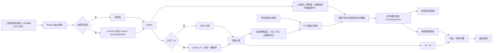

# 语音换音功能开发计划

> 状态：开发完成，140 部署验收通过（2026-11-04）。Chatterbox VC、Seed-VC、Demucs 均已在 140 端到端冒烟；默认换音模型 `chatterbox`，`separate_available=true`。
> **范围声明：本计划只负责软件开发（接口、任务、页面、画布节点、兼容代码与文档）。不负责模型权重下载、GPU 主机部署、离线缓存准备或线上模型验收。**
>
> 权重正在由运维手动上传到 140 主机；本文只约定代码读取路径、缺失时报错方式和验收项，不在开发任务里执行下载。

新增「换音」能力：输入音频或视频，选择音色库里的音色，保持说话时间轴不变，只替换音色；同时输出 srt/vtt 字幕，视频可选烧录字幕。语音服务代码侧接入 Chatterbox VC（默认）和 Seed-VC 两个模型选项，外加 Demucs 背景音分离开关；主服务新增 `vc` 能力、任务、独立页面和画布节点模式。

## 本轮讨论结论

1. **分段对齐**：两个模型都按字幕段切块转换。每段前后补少量上下文，转换后裁剪或补静音到原切片长度，段边界加 20–30ms 淡入淡出。长段在内部再切成 15–20 秒窗口，但字幕仍保留原 ASR/srt 分段。
2. **SRT 覆盖不全**：未覆盖区间保留原始人声，不丢话。开背景音分离时用 vocals 轨垫底，最后再混回 accompaniment；页面提示“未覆盖部分保留原声”，任务 meta 记录覆盖率。
3. **画布产物**：随输入动态。输入音频输出音频；输入视频输出视频，音频作为附带产物。换音节点在连入上游时记录解析出的产物类型，下游按实际类型连接。
4. **时长上限**：除 200MB 外，输入媒体上限 30 分钟。路由层探测后直接拒绝，画布 runner 对已保存资产再校验一次。
5. **其他约定**：
   - 换音页面只列有 `vc` 能力的服务；字幕识别固定用同一个 Liber Speech 的 ASR，模型跟随系统设置 `default_asr_model`。
   - 上传 srt 时跳过识别；srt 和 ASR 都只做转写，不翻译。
   - 音频支持 mp3 / wav：独立页面默认 mp3，可选 wav；画布节点默认 wav，高级参数可改。视频音轨 aac；混音用 `amix=normalize=0`，转换段做简单响度匹配。
   - 画布换音节点属性面板提供完整配置：默认自动 ASR，可上传 srt；视频输入可开烧录字幕、字号、颜色；高级参数默认折叠。
   - 快捷菜单的「音色替换」由画布菜单设置驱动，`vc` 是普通子能力，不在快捷菜单里写死。
   - 导演台画布技能支持「音色替换」；CLI/MCP 本期不做。

## 已确认需求

- 输入：一个音频或视频文件（上限 200MB、30 分钟）。目标音色只从音色库选，且记录必须有 `ref_audio_path`。
- 时间轴：换音后每句话的时间点和原音频一致。
- 可选「分离背景音」开关，默认关闭：先拆出人声和背景音，只对人声换音色，最后把背景音混回去。
- 字幕：默认对人声自动识别（ASR）；也可上传 srt 替代，此时跳过识别。字幕和原话同语言，不翻译。
- 视频：输出替换音轨后的视频；可选烧录字幕，字号和颜色可调。
- 多人说话时，全部换成同一个目标音色。
- 入口：独立页面，加画布语音节点的 `vc` 模式。
- 模型选择机制与 TTS / ASR 一致，新增 `vc` 能力。语音服务环境变量 `LIBER_SPEECH_VC_MODEL` 默认 `chatterbox`；系统设置留空时跟随它，请求不传模型时用默认值。

## 环境与权重准备

### 140 主机路径

宿主机权重根目录：`/home/ps/workspace/liberastra-speech/models`，通过 `LIBER_SPEECH_MODELS_DIR` 挂到容器 `/models`。

| 本机上传目录 | 140 宿主机目标 | 容器内路径 | 说明 |
| --- | --- | --- | --- |
| `01-chatterbox-vc/s3gen.safetensors` | `/home/ps/workspace/liberastra-speech/models/models--ResembleAI--chatterbox/snapshots/<现有快照目录>/s3gen.safetensors` | `/models/models--ResembleAI--chatterbox/snapshots/<快照>/s3gen.safetensors` | 与已有 `s3gen.pt` 同目录；同目录还必须有 `conds.pt` |
| `02-seed-vc/` | `/home/ps/workspace/liberastra-speech/models/Seed-VC/` | `/models/Seed-VC/` | 主权重 `DiT_seed_v2_uvit_whisper_small_wavenet_bigvgan_pruned.pth` 与 `config_dit_mel_seed_uvit_whisper_small_wavenet.yml` |
| `03-whisper-small/` | `/home/ps/workspace/liberastra-speech/models/whisper-small/` | `/models/whisper-small/` | `model.safetensors`、配置和分词器文件 |
| `04-campplus/` | `/home/ps/workspace/liberastra-speech/models/campplus/` | `/models/campplus/` | `campplus_cn_common.bin` |
| `05-bigvgan/` | `/home/ps/workspace/liberastra-speech/models/bigvgan_v2_22khz_80band_256x/` | `/models/bigvgan_v2_22khz_80band_256x/` | `bigvgan_generator.pt` 与 `config.json` |
| `06-demucs-htdemucs/` | `/home/ps/workspace/liberastra-speech/models/demucs/` | `/models/demucs/` | `htdemucs-955717e8-8726e21a.th` |

完整下载清单和地址见 [`docs/Liberastra部署相关资源下载.md`](../../docs/Liberastra部署相关资源下载.md) 的「VC 换音」一节。

本机整理包：`D:\BaiduSyncdisk\mydir\W-文字语音转换\VC(语音换音)`。已核对：

- `01-chatterbox-vc/` 只有 `s3gen.safetensors`，没有 `conds.pt`；140 快照目录里已有 `conds.pt` 和 `s3gen.pt` 的软链接，`ChatterboxVC.from_local` 可以正常读取。检查时注意 `find -type f` 不会列出软链接，要用 `ls -la` 或 `find -L`。
- `05-bigvgan/` 是完整的 BigVGAN 仓库，除 `config.json`、`bigvgan_generator.pt` 外还有 `bigvgan.py`、`alias_free_activation/` 等代码；代码只需要权重和 config，若 Seed-VC 通过 `import bigvgan` 加载，则需要安装该包或把目录加到 `sys.path`。
- `06-demucs-htdemucs/` 的文件名是 `htdemucs-955717e8-8726e21a.th`，带 `htdemucs-` 前缀；代码会归一化到 `$TORCH_HOME/hub/checkpoints/955717e8-8726e21a.th`。
- `02-seed-vc/` 的 config 里还有 `timbre_shifter` 的 OpenVoice 路径（`se_db.pt`、`checkpoints_v2`）和训练用的 `pretrained_encoder: ./temp_ckpt.pth`。按 `seed-uvit-whisper-small-wavenet` 变体推理通常不加载这些；接入 Seed-VC 源码时要确认，若实际加载则还缺 OpenVoice 权重。
- `03-whisper-small/`、`04-campplus/` 内容完整。

2026-11-04 只读核对（`/home/ps/workspace/liberastra-speech/models`）：

- Chatterbox 快照 `models--ResembleAI--chatterbox/snapshots/05e904af2b5c7f8e482687a9d7336c5c824467d9/`：`s3gen.safetensors` 1,056,484,620 bytes；`conds.pt`、`s3gen.pt`、`ve.pt` 等为软链接，实际存在。
- Seed-VC：`config_dit_mel_seed_uvit_whisper_small_wavenet.yml` 2,289 bytes；`DiT_seed_v2_uvit_whisper_small_wavenet_bigvgan_pruned.pth` 440,312,082 bytes。
- whisper-small：`model.safetensors` 966,995,080 bytes，配置/分词器齐全。
- campplus：`campplus_cn_common.bin` 28,036,335 bytes。
- BigVGAN：`bigvgan_generator.pt` 449,228,171 bytes；`config.json` 1,405 bytes。
- Demucs：`htdemucs-955717e8-8726e21a.th` 84,141,911 bytes。
- 磁盘剩余约 143G。

### 代码读取路径

- Chatterbox VC：自动查找 `/models/models--ResembleAI--chatterbox/snapshots/*/` 下同时存在 `s3gen.safetensors` 与 `conds.pt` 的快照目录；找不到时可用 `LIBER_SPEECH_CHATTERBOX_VC_DIR` 指定。`s3gen.pt` 是 TTS 用的，VC 不读取它，不要靠改名顶替。
- Seed-VC：`LIBER_SPEECH_SEEDVC_DIR` 默认 `/models/Seed-VC`；`LIBER_SPEECH_WHISPER_SMALL_DIR` 默认 `/models/whisper-small`；`LIBER_SPEECH_CAMPPLUS_DIR` 默认 `/models/campplus`；`LIBER_SPEECH_BIGVGAN_DIR` 默认 `/models/bigvgan_v2_22khz_80band_256x`。推理入口和配置覆盖使用这些路径，不依赖上游写死的 `./checkpoints`。
- Demucs：`LIBER_SPEECH_DEMUCS_DIR` 默认 `/models/demucs`。compose 设置 `TORCH_HOME=/models`。启动时把目录里的 `.th` 归一化到 `$TORCH_HOME/hub/checkpoints/955717e8-8726e21a.th`（复制或软链），避免 `HF_HUB_OFFLINE=1` 时仍尝试联网。若该目录本身就是带 `hubconf.py` 的本地 Torch Hub 仓库，也允许直接 `repo=` 指向它。
- 缺权重时接口返回可读错误，列出缺失的文件名和预期路径；不要静默退回下载。

### 离线

140 的 compose 建议设置 `HF_HUB_OFFLINE=1`、`TRANSFORMERS_OFFLINE=1`。开发/CI 不依赖真实权重，用 mock 适配器测试流程。

## 整体流程

## 一、语音服务 `services/speech`（开发）

### 1. 模型目录与默认值

- 新增 `vc_catalog()`：返回 `chatterbox`（Chatterbox VC）和 `seed-vc`（Seed-VC V1，模型 `seed-uvit-whisper-small-wavenet`）。
- 新增 `default_vc_model()`，读取 `LIBER_SPEECH_VC_MODEL`，默认 `chatterbox`；别名 `seed_vc`、`chatterbox-vc` 归一到标准 id。
- `configured_models()` 可以继续只列 ASR/TTS；VC 走独立的 `vc_catalog()`。

### 2. `convert(source, *, model, prompt, segments)`

逐段转换的具体算法：

1. 读取 `source`，按模型采样率解码；保留源采样率用于回写。
2. 归一化分段：排序、丢弃零长度/负长度段，合并重叠或间隔小于 50ms 的相邻段。分段为空时抛 `ValueError`，不能输出全静音。
3. 生成转换窗口：每段前后补约 0.15s 上下文，夹到源时长和相邻段内；超过 20 秒的段优先在低能量点切分，找不到静音点再等分。窗口只用于模型推理，字幕仍用原分段。
4. 逐窗口转换。结果重采样回源采样率，裁剪或补静音到窗口长度，窗口两端加 20–30ms 淡入淡出。
5. 以输入音频本身作为底轨（分离场景下输入是 vocals）；只把每个窗口对应原分段的区间覆盖到底轨，补的上下文不写回。这样未覆盖区间自然保留原人声。
6. 返回一条和源音频等长的 wav，并释放模型。

模型细节：

- Chatterbox VC：优先 `ChatterboxVC.from_local(snapshot_dir)`；每次请求只调用一次 `set_target_voice(prompt)`，逐段 `generate(window_path)` 复用目标音色。输出是 24k，模型内部会裁掉约 20ms，必须做裁剪/补齐。
- Seed-VC：使用 `length_adjust=1.0`，保证帧数不变；仍按窗口长度做最后裁剪/补齐。
- 参考音频超过模型内部上限时由模型截断；音色库参考音频为空直接报错。

### 3. `separate(path)`

- 用 Demucs `htdemucs` 输出 `vocals` 和 `no_vocals`（伴奏）两轨，44.1k 立体声。
- 权重按上面的 `LIBER_SPEECH_DEMUCS_DIR` / `TORCH_HOME` 规则读取。
- `separate_available()`：`demucs` 可导入且本地权重存在时为 true；`/models` 用它告诉前端是否显示开关。

### 4. 锁与显存

- 新增 `_vc`、`_vc_id`、`_separator` 等全局状态，以及 `_load_vc()`、`_drop_vc()`、`_load_separator()`、`_drop_separator()`。
- `_lock` 是普通 `threading.Lock`，不能嵌套。`convert` 内不要调用同样加锁的 `transcribe` / `separate`；需要组合时由上层主服务分两次 HTTP 请求完成。
- 每次转换或分离结束后释放模型并调用 `_release_cuda()`，与现有 TTS/ASR 的“用完即释放”一致。

### 5. HTTP 接口

- `GET /api/v1/models` 追加：
  - `vc_models`：`[{"id": "chatterbox", "label": "Chatterbox VC"}, {"id": "seed-vc", "label": "Seed-VC"}]`
  - `default_vc_model`：环境变量默认值
  - `separate_available`：布尔值
- `POST /api/v1/vc/convert`：表单字段 `file`（音频）、`prompt`（目标音色参考音频）、`model`、`segments`（JSON 数组，元素 `{start, end}`，可选）。返回 `audio_url` 和 `meta`（格式、采样率、时长、分段数）。服务端也校验 30 分钟上限。
- `POST /api/v1/audio/separate`：上传音频，返回 `vocals_url`、`accompaniment_url`。
- 错误约定：参数/分段非法 400；依赖缺失 503；推理失败 500，错误里带模型名和缺失权重路径。

### 6. 依赖、镜像与文档

- `requirements.txt` 增加 `munch`、`demucs`。如果 demucs 依赖过重，用 `--no-deps` 安装再补必要小包；Dockerfile 装完后仍要钉回 CUDA 版 torch/torchaudio。
- Dockerfile 把 `third_party/seed_vc/` 拷进镜像；compose 以只读方式挂载 `third_party`。
- compose 增加 `LIBER_SPEECH_VC_MODEL`、`LIBER_SPEECH_SEEDVC_DIR`、`LIBER_SPEECH_WHISPER_SMALL_DIR`、`LIBER_SPEECH_CAMPPLUS_DIR`、`LIBER_SPEECH_BIGVGAN_DIR`、`LIBER_SPEECH_DEMUCS_DIR`、`TORCH_HOME=/models`。
- `services/speech/README.md` 说明 VC 接口、分离接口、新环境变量、离线权重路径和 GPL-3.0 声明。

### 7. Seed-VC 兼容补丁

- `third_party/seed_vc/` 只放推理需要的 `modules/` 和 V1 离线换音配置 yml；附原版 GPL-3.0 `LICENSE` 和 `UPSTREAM.md`（上游仓库、commit、裁剪范围）。
- `_ensure_seedvc_compat()`：占位注册 `dac.nn.quantize`；把权重路径改为上面四个 `/models` 目录；写法参照现有 `_ensure_qwen_transformers_compat()`。

## 二、主服务 backend（开发）

### 1. Provider 与适配器

- [`backend/liberastra/providers/__init__.py`](../../backend/liberastra/providers/__init__.py)：`liber_speech` 能力改为 `("tts", "asr", "vc")`。
- [`backend/liberastra/providers/speech/liber_speech.py`](../../backend/liberastra/providers/speech/liber_speech.py)：
  - 新增 `canonical_vc_model()`：空、`default`、`chatterbox`、`seed-vc` 合法，未知值报 `ValueError`。
  - 新增 `convert_voice(...)`：把源音频和参考音频上传到 `/vc/convert`，把返回的 `audio_url` 下载到指定 `out_path`，避免大文件常驻内存。使用独立长超时（1800 秒）。
  - 新增 `separate(...)`：上传音频，把 `vocals_url`、`accompaniment_url` 下载到指定路径。
  - `list_catalog()` 追加 `vc_models`、`default_vc_model`、`separate_available`。旧版语音服务缺这些字段时返回空列表 / 空串 / false，不报错。
  - `list_models()` 追加 `... · VC` 行，便于 Provider 模型目录和画布菜单识别。
- [`backend/liberastra/services/providers.py`](../../backend/liberastra/services/providers.py)：新增 `build_vc_adapter` 和 `_speech_default_vc_model`。构造 `LiberSpeech` 时同时传入 `_speech_default_asr_model(db, extra_asr)`，确保换音任务里的 ASR 跟随系统设置；`pick_provider(db, "vc", ...)` 自动生效。
- [`backend/liberastra/providers/catalog.py`](../../backend/liberastra/providers/catalog.py)：`model_profile()` 的 `liber_speech` 子能力增加 `vc`；`classify_remote()` 能识别 `... · VC` 行并落到 `category="vc"`、`sub_capabilities=["vc"]`。

### 2. 偏好设置

- [`backend/liberastra/services/preferences.py`](../../backend/liberastra/services/preferences.py)：`STR_SPECS` 增加 `default_vc_model`，默认空串表示跟随语音服务；`set_str_pref` 用 `canonical_vc_model` 校验。
- [`backend/liberastra/api/routes/system.py`](../../backend/liberastra/api/routes/system.py)：`PreferencesUpdate` 增加 `default_vc_model`；`/system/speech-models` 已返回完整 catalog，前端直接读取 `vc_models`。

### 3. 字幕与 ffmpeg

- [`backend/liberastra/media/subtitles.py`](../../backend/liberastra/media/subtitles.py)：新增 `parse_srt(path, duration)`，返回 `(segments, coverage)`。
  - 解码优先 `utf-8-sig`，失败回退 `gb18030`。
  - 支持 `HH:MM:SS,mmm --> HH:MM:SS,mmm` 和点号毫秒；去掉 HTML 标签。
  - 丢掉零长度/负长度段，合并重叠或间隔小于 50ms 的相邻段；格式不对直接报错。
  - 最后时间戳超出音频时长 0.5 秒以上报错，0.5 秒以内截断；返回覆盖率 `0..1`。
  - 无有效分段时报错，避免后续输出全静音。
- [`backend/liberastra/media/ffmpeg.py`](../../backend/liberastra/media/ffmpeg.py)：
  - 新增 `extract_audio()`：抽第一条音轨为 wav，保留源采样率/声道。
  - 新增 `mix_tracks(vocals, accompaniment, out)`：`amix=inputs=2:duration=first:dropout_transition=0:normalize=0`，混音前用 `aresample`/`aformat` 对齐采样率和声道。
  - 新增 `encode_audio(input, out, fmt)`：`wav` 直接保留；`mp3` 用 `libmp3lame` 转码。视频流程只用 wav 中间文件。
  - 新增 `burn_subtitles(video, audio, subtitle, out, size, color)`：`subtitles` 滤镜 + `_force_style`，视频重编码 libx264，音频 aac；字号 `0` 时按视频高度计算默认值。
  - 不烧录字幕时复用现有 `replace_audio`（视频流直接 copy）。
  - 复用现有 `probe_duration`、`probe_video_size`、`_escape_filter_path`、`_ass_color`。

### 4. VC runner

新增 [`backend/liberastra/services/vc.py`](../../backend/liberastra/services/vc.py)，任务 `vc.convert`：

1. `pick_provider(db, "vc", job.provider_id)`，构造 `build_vc_adapter`。
2. 校验输入存在、探测时长；超过 30 分钟或没有音轨直接报可读错误。
3. 抽音轨到 `outputs/{job.id}/work/source.wav`。
4. `separate_bgm` 为真时调用 `adapter.separate()` 得到 vocals/accompaniment；否则 vocals 就是 source。
5. 有上传 srt：`parse_srt(..., duration)`；没有：`adapter.transcribe(vocals, language, task="transcribe")`。分段为空报错。
6. `adapter.convert_voice(vocals, prompt=voice.ref_audio_path, segments, model=job.model, out_path=converted.wav)`。
7. 有伴奏时 `mix_tracks(converted, accompaniment, final.wav)`；否则 `final = converted`。
8. 按请求的 `format` 输出音频：`wav` 直接保留；`mp3` 用 ffmpeg `libmp3lame` 转码。视频流程始终用 wav 中间文件，最终视频音轨用 aac。
9. 导出 srt/vtt；输入是视频时用 `replace_audio` 或 `burn_subtitles` 出视频。
10. 产物：音频 mp3/wav；srt、vtt；视频输入时再加视频。音频 meta 写入 `srt_coverage`、`language`、`model`、`voice`、`separate_bgm`、`format` 等。
11. 阶段之间调用 `ctx.report`，并在每个阶段前检查 `ctx.cancelled()`。单次 `convert_voice` 请求内部不可中断，取消只保证阶段边界生效。

### 5. 路由与注册

新增 [`backend/liberastra/api/routes/vc.py`](../../backend/liberastra/api/routes/vc.py)：

- `POST /vc`，multipart：
  - `file`（音频或视频，必填）
  - `voice_record_id`（必填，记录必须属于当前用户且有 `ref_audio_path`）
  - `provider_id`、`model`
  - `format`（`mp3` 默认 / `wav`）
  - `separate_bgm`
  - `subtitle`（可选 srt）
  - `language`
  - `burn_subtitles`、`subtitle_size`、`subtitle_color`
  - `wait`（与其他媒体路由一致，可选）
- 校验：空文件 400；超过 200MB 413；时长超过 30 分钟 400；`burn_subtitles` 只允许视频输入；音色不存在/无参考音频 400；Provider 没有 `vc` 能力由 `pick_provider` 返回 400。
- 保存上传文件后用 `probe_duration` 探测时长；拒绝时删除已保存文件。
- 在 [`backend/liberastra/api/__init__.py`](../../backend/liberastra/api/__init__.py) 注册路由，在 [`backend/liberastra/main.py`](../../backend/liberastra/main.py) 注册 `register_vc_jobs`。
- 支持的音频/视频扩展名和 ffprobe 探测结果不一致时，以 ffprobe 为准。

### 6. 画布 runner

[`backend/liberastra/services/canvas_run.py`](../../backend/liberastra/services/canvas_run.py) 的 `_execute_speech` 增加 `mode == "vc"`：

- 上游取第一个音频或视频资产；没有则报“换音节点需要连接音频或视频输入”。
- 读取 `voiceRecordId`，校验归属和 `ref_audio_path`。
- 读取 `subtitleAssetId`：有值时校验资产归属和 `kind == "subtitle"`，传 `subtitle_path`；没有则自动 ASR。
- 参数：`file_path`、`voice_record_id`、`subtitle_path`、`separate_bgm`、`language`、`burn_subtitles`、`subtitle_size`、`subtitle_color`、`format`、`kind`（audio/video）、`source_asset_id`。
- 校验：`burn_subtitles` 只允许视频；`format` 只允许 `mp3` / `wav`；`subtitleAssetId` 必须有对应的 srt 文件。
- 指纹包含源资产 id、音色记录 id、字幕资产 id、烧录参数、Provider、模型、`separate_bgm`、`format`、语言。
- 成功后把该任务所有资产标 `hidden` 和 `canvas_temp`；`row.asset_ids` 包含音频、字幕，视频输入时再包含视频。
- 输出类型按输入动态：音频输入出音频，视频输入出视频（音频和字幕作为附带产物）。

### 7. 画布菜单的 `vc` 能力

- [`backend/liberastra/providers/catalog.py`](../../backend/liberastra/providers/catalog.py)：
  - `SUB_CAPABILITIES` 增加 `vc`：`menu="speech"`、`category="vc"`、`label="音色替换"`，先声明一个必选音频槽用于快速建点；视频由连线校验允许。
  - `default_canvas_menu()` 增加 `preset_vc`（`speech` / `音色替换` / `vc`），作为默认菜单项；用户可以在「画布菜单设置」里改名、禁用、改绑定。
  - `merge_factory_items()` 调整：旧画布保留用户配置的语音项，但补上新增的 `preset_vc`；`MENU_REVISION` 加 1。
- [`frontend/src/components/canvas/CanvasMenuSettings.tsx`](../../frontend/src/components/canvas/CanvasMenuSettings.tsx) 的 `ABILITIES` 增加 `vc`，让用户能像 tts/asr 一样新增、编辑「音色替换」菜单项。
- `QuickAddMenu`、`applyMenu`、`NodeInspector` 的语音模式按 `sub_capability` 统一映射为 `SpeechMode`，不要再写死 `asr ? "asr" : "tts"`。
- 画布菜单解析到模型时，`model_specs` 只包含 Provider 目录里启用的项；换音页面和节点属性仍可直接从 `vc_models` 选模型，不依赖目录启用状态。

## 三、前端 frontend（开发）

### 1. 独立页面

新增 [`frontend/src/pages/VcPage.tsx`](../../frontend/src/pages/VcPage.tsx)，布局参照 [`frontend/src/pages/TtsPage.tsx`](../../frontend/src/pages/TtsPage.tsx)：

- 左侧：
  - 服务：只列已启用且具备 `vc` 能力的 Provider。
  - 模型：来自 `speechCatalog.vc_models`；空选项表示系统设置。`vc_models` 为空时显示“语音服务未提供换音模型，请升级语音服务”，并禁用提交。
  - 音色库：只显示 `ref_audio_path` 非空的记录。
  - 上传素材：音频或视频；提示 200MB / 30 分钟。
  - 分离背景音：`separate_available` 为 false 时禁用并给提示。
  - 可选 srt 上传；提示“未覆盖部分保留原声”。
  - 语言：上传 srt 时可隐藏或标注“识别用，上传 srt 时忽略”。
  - 音频格式：mp3（默认）/ wav。
  - 视频输入时显示烧录字幕、字号、颜色。
- 右侧：`ResultPanel`；音频/视频按输入类型切换；结果里显示 `srt_coverage`。
- 提交调用 `api.submitVc`；成功后用 `useTrackedJob("vc")` 跟踪。

注册：

- [`frontend/src/App.tsx`](../../frontend/src/App.tsx)：`/speech/vc` 路由。
- [`frontend/src/nav/model.ts`](../../frontend/src/nav/model.ts)：语音组增加「换音」。
- [`frontend/src/components/PageShell.tsx`](../../frontend/src/components/PageShell.tsx)：Kind 增加 `vc` 和图标。
- [`frontend/src/api/client.ts`](../../frontend/src/api/client.ts)：`SpeechModelCatalog` 增加 `vc_models`、`default_vc_model`、`separate_available`；`SystemPreferences` 增加 `default_vc_model`；新增 `submitVc`。
- [`frontend/src/i18n/ui-en.ts`](../../frontend/src/i18n/ui-en.ts)：补齐英文文案。

### 2. 系统设置

[`frontend/src/pages/SystemSettingsPage.tsx`](../../frontend/src/pages/SystemSettingsPage.tsx) 新增「默认换音模型」下拉：

- 选项来自 `vc_models`，空值表示跟随语音服务。
- `vc_models` 为空时禁用并提示升级语音服务。
- 保存到 `default_vc_model`。

### 3. 画布

- [`frontend/src/canvas/types.ts`](../../frontend/src/canvas/types.ts)：`SpeechMode` 增加 `"vc"`；`SpeechNodeData` 增加：
  - `outputKind?: MediaKind | null`（vc 节点记录解析出的产物类型）
  - `separateBgm?: boolean`
  - `subtitleAssetId?: number | null`、`subtitleName?: string`
  - `burnSubtitles?: boolean`、`subtitleSize?: number`、`subtitleColor?: string`
  - `format?: "mp3" | "wav"`
- `nodeOutputKind()`：tts → audio；asr → null；vc → `data.outputKind ?? "audio"`。
- [`frontend/src/stores/canvas.ts`](../../frontend/src/stores/canvas.ts)：vc 建点时默认 `output_audio`；连入视频后改成 `output_video`（只在变量名仍是自动生成名时改）。
- [`frontend/src/canvas/applyMenu.ts`](../../frontend/src/canvas/applyMenu.ts)：
  - `mode` 按 `item.sub_capability` 统一映射为 `SpeechMode`，不再写死 tts/asr。
  - `incomingCount()` 改为按 `nodeOutputKind(source)` 判断，不再用 `mode !== "asr"` 一刀切。
- [`frontend/src/components/canvas/QuickAddMenu.tsx`](../../frontend/src/components/canvas/QuickAddMenu.tsx)：`speechMode` 直接取 `item.sub_capability`（speech 类），不再只认 asr。
- [`frontend/src/canvas/refs.ts`](../../frontend/src/canvas/refs.ts)：`vc` 节点标签「音色替换」。
- [`frontend/src/components/canvas/CanvasMenuSettings.tsx`](../../frontend/src/components/canvas/CanvasMenuSettings.tsx)：能力列表和子能力选项增加 `vc`。
- [`frontend/src/components/canvas/NodeInspector.tsx`](../../frontend/src/components/canvas/NodeInspector.tsx)：语音节点增加 `vc` 模式配置：
  - 常驻区：服务、模型（`vc_models`，空 = 系统设置）、音色库（有参考音频）、分离背景音。
  - 字幕来源：默认「自动识别」；可切到「上传 srt」，用 `api.uploadFileAsAsset(file, "subtitle", true)` 存成隐藏字幕资产，节点只保存 `subtitleAssetId` / `subtitleName`，并显示文件名和清除按钮。替换或清除时尽量删除旧的隐藏资产，失败不阻断操作。
  - 高级参数（`AdvancedPanel` 默认折叠）：语言、烧录字幕开关、字号、颜色、音频格式（wav 默认 / mp3）。
  - 输入是视频时烧录开关才可用；音频输入时隐藏或禁用。
- [`frontend/src/canvas/validation.ts`](../../frontend/src/canvas/validation.ts) 和 [`frontend/src/canvas/preflight.ts`](../../frontend/src/canvas/preflight.ts)：
  - 上游必须是音频或视频。
  - vc 节点必须选音色（`voiceRecordId`）。
  - 字幕来源为 srt 时必须有 `subtitleAssetId`；烧录字幕只允许视频输入。
  - 下游连线按 `outputKind` 校验。
- 在建立/删除上游连线后重算 vc 节点的 `outputKind`；没有上游时默认 audio。

### 4. 导演台画布技能

- [`frontend/src/director/clientTools.ts`](../../frontend/src/director/clientTools.ts)：
  - `KIND_ALIASES` 增加 `vc`、`voice_replace`、`voice_conversion` → `{ kind: "speech", data: { mode: "vc" } }`。
  - `EDITABLE_FIELDS.speech` 增加 `separateBgm`、`subtitleAssetId`、`subtitleName`、`burnSubtitles`、`subtitleSize`、`subtitleColor`、`outputKind`、`format`。
  - `canvas_apply_menu` 允许 `speech` 节点套用语音菜单项（tts / asr / vc），`canvas_apply_pack` 仍只允许功能节点。
  - `canvas_get_node_schema` 对 speech 节点返回当前 mode 和可编辑字段，方便导演先读再改。
- [`backend/liberastra/agent/tools.py`](../../backend/liberastra/agent/tools.py)：
  - `canvas_add_node` 描述补充「音色替换用 speech + data.mode=vc」，`kind` enum 加入 `vc`（客户端别名解析到 speech）。
  - `canvas_apply_menu` 描述补充「语音节点也可套用 list_canvas_menu 里的音色替换项」。
  - `canvas_update_node` 描述补充 vc 的字幕/烧录字段。
- [`backend/liberastra/agent/skills/canvas-auto/SKILL.md`](../../backend/liberastra/agent/skills/canvas-auto/SKILL.md)：新增「音色替换」流程：
  1. `canvas_add_node(kind="speech", data={mode:"vc"})` 或 `kind="vc"`。
  2. `list_canvas_menu` 找「音色替换」项，`canvas_apply_menu` 套用。
  3. `canvas_update_node` 写 `voiceRecordId`、`providerId`、`model`、`separateBgm`、`subtitleAssetId`、`burnSubtitles` 等。
  4. 连入音频或视频，执行；说明输出类型随输入变化。
- [`backend/liberastra/agent/skills/director/SKILL.md`](../../backend/liberastra/agent/skills/director/SKILL.md)：在成片之后增加可选「音色替换」分支：把最终视频/音频接到 vc 节点，选音色、是否分离背景音、是否烧录字幕，确认后执行。

## 四、测试与文档（开发）

- 后端测试（参照 `backend/tests/test_speech.py` 和 `test_speech_adapters.py`）：
  - `parse_srt`：UTF-8 BOM、GB18030、正常段、重叠段、零长度段、最后时间戳越界、空文件。
  - `convert` 的窗口规划（纯函数，不加载模型）：补上下文、长段切分、重叠合并、未覆盖区间保留。
  - VC runner（mock 适配器）：音频输入、视频输入、烧录、上传 srt、分离背景音、30 分钟拒绝、srt 覆盖率、mp3/wav 输出。
  - 路由参数校验：200MB、30 分钟、音色归属/参考音频、音频输入时拒绝烧录、`format` 校验。
  - Provider 能力、旧版语音服务缺 `vc_models`、`default_vc_model` 校验。
  - 画布 `vc` 节点：动态产物类型、`subtitleAssetId` 归属校验、烧录只允许视频、连线校验。
  - 画布菜单：`preset_vc` 迁移只补一次、用户改名/禁用后不被覆盖、`SpeechMode` 按 `sub_capability` 映射。
  - 导演台：`vc` 别名、speech 节点套用语音菜单、`canvas_update_node` 写入字幕/烧录字段。
- 文档：
  - [`site/docs-src/guides/speech.md`](../../site/docs-src/guides/speech.md) 和 [`docs/使用文档.md`](../../docs/使用文档.md) 补充换音页面、画布节点、字幕和限制。
  - `services/speech/README.md` 补充 VC/分离接口、环境变量、运维权重清单和 GPL-3.0 声明。
  - [`docs/Liberastra部署相关资源下载.md`](../../docs/Liberastra部署相关资源下载.md) 已有 VC 权重表，补充 `LIBER_SPEECH_*_DIR` 和 `TORCH_HOME` 说明。
  - 打包文档说明 `packaging/speech` 会自动带上 `third_party`，发布包需要附 Seed-VC 的 GPL LICENSE 和源码说明。

## 本期不做

- CLI / MCP 的换音命令；当前项目这两块功能本身还不完善，后续再补。
- 说话人分离；多人统一换同一目标音色。

## 运维侧备忘

以下由运维或验收单独排期；开发只保证代码按约定路径读权重、缺文件时报错清晰。

- [x] 已确认 `s3gen.safetensors` 与 `conds.pt` 在同一个 `models--ResembleAI--chatterbox/snapshots/05e904af2b5c7f8e482687a9d7336c5c824467d9/` 目录；`conds.pt` / `s3gen.pt` 是软链接，实际存在。`s3gen.pt` 继续给 TTS 用。
- [x] 已确认 `/models/Seed-VC/` 有主权重和配置 yml。
- [x] 已确认 Seed-VC 的 `timbre_shifter` 不会被当前推理变体加载，不需要 OpenVoice 的 `se_db.pt` 和 `checkpoints_v2`；140 实际换音已验证。
- [x] 已确认 `/models/whisper-small/` 有 `model.safetensors`、配置和分词器。
- [x] 已确认 `/models/campplus/campplus_cn_common.bin`。
- [x] 已确认 `/models/bigvgan_v2_22khz_80band_256x/` 有 `bigvgan_generator.pt` 和 `config.json`。140 已用本地 config/权重直接加载，绕开 `huggingface_hub` 的 `from_pretrained` 兼容问题。
- [x] 已确认 `/models/demucs/htdemucs-955717e8-8726e21a.th`；代码会归一化到 `$TORCH_HOME/hub/checkpoints/955717e8-8726e21a.th`。
- [x] 已用临时凭据完成一次只读核对；开发机没有配置持久 SSH 密钥，后续部署/验收需要再提供访问方式。
- [x] 重启语音服务后，`GET /api/v1/models` 返回 `vc_models`（chatterbox、seed-vc）、`default_vc_model=chatterbox` 和 `separate_available=true`。
- [x] 已用中文样例跑通 Chatterbox VC、Seed-VC、Demucs；默认模型保持 `chatterbox`，分离开关已开放。
- [x] 两个换音模型与 Demucs 在 140 均可用，无需下线；继续保留两者供页面和画布选择。

## 风险（开发侧）

- 逐段转换的段边界可能出现轻微不自然；通过上下文、淡入淡出和静音点切分降低。
- 不分离背景音时，残留音乐/噪声会经过 VC 变杂音；页面要提示。
- Seed-VC 与 transformers 5.2 / numpy 2.x 的边界行为需在有权重的环境验证；开发阶段用兼容补丁和 mock 契约兜底。
- Chatterbox VC 的中文效果尚未实机验收；默认仍 `chatterbox`，验收后如不达标可改默认 `seed-vc` 或在页面标注推荐。
- Seed-VC 为 GPL-3.0：仓库可 vendoring 源码并附 `LICENSE` / `UPSTREAM.md`；如果发布形态要求闭源，需要改成部署时下载，不能进安装包。
- Demucs 权重目录结构可能与代码预期不一致；上传后先确认 `.th` 文件名和目录结构。
- 30 分钟上限是硬限制；超长素材直接拒绝，避免逐段推理时间和显存不可控。
- 画布动态产物类型需要同时改 `nodeOutputKind`、连线和变量名，漏改会出现“音频节点接视频”的假校验。
- 画布 srt 以隐藏资产保存，必须校验归属和 `kind=="subtitle"`；否则画布复制、共享或清理后可能出现悬空资产。
- 菜单迁移要同时处理 `MENU_REVISION`、用户已删除项和自定义标题；`preset_vc` 只能补一次，不能把用户删掉的项反复加回来。
- 导演台工具和白名单要同步；只改画布不改 `clientTools.ts` / skill 时，导演仍无法创建或配置音色替换节点。
- mp3 转码会增加一次 ffmpeg 处理；视频流程不要用 mp3 中间文件，避免重复有损。

## 开发任务清单

1. 引入 `third_party/seed_vc`（GPL LICENSE + UPSTREAM.md），更新 requirements、Dockerfile、compose。
2. `engine.py`：`vc_catalog`、`default_vc_model`、`convert`（窗口规划 + 裁剪补齐 + 原人声底轨）、`separate`、Seed-VC 兼容补丁、Demucs 本地权重归一化。
3. `server.py`：`/vc/convert`、`/audio/separate`，`/models` 追加 `vc_models`、`default_vc_model`、`separate_available`；更新语音服务 README。
4. 主服务：`liber_speech` 增加 `vc` 能力，适配器 `convert_voice` / `separate`，`build_vc_adapter`，`default_vc_model` 偏好项和 system 路由。
5. `subtitles.parse_srt`，ffmpeg 增加 `extract_audio`、`mix_tracks`、`burn_subtitles`。
6. `services/vc.py` 任务 runner 与 `api/routes/vc.py` 路由，注册任务和路由；加 200MB / 30 分钟校验。
7. `canvas_run` 语音节点新增 `vc` 模式：动态产物、`subtitleAssetId`、烧录参数、输出格式。
8. Provider 目录增加 `vc` 子能力、`preset_vc`（默认标题「音色替换」）、`MENU_REVISION` 迁移。
9. `VcPage` 独立页面：srt 上传、烧录、字号颜色、mp3/wav，以及路由、菜单、`client.submitVc`、英文文案。
10. 系统设置「默认换音模型」。
11. 画布前端：`SpeechMode`、`nodeOutputKind`、`applyMenu`、`QuickAddMenu`、`refs`、`CanvasMenuSettings`、`NodeInspector`（含 srt 上传和 `AdvancedPanel`）、`validation` / `preflight`。
12. 导演台：`clientTools.ts`、`agent/tools.py` 描述、`canvas-auto` / `director` SKILL.md 支持「音色替换」。
13. 后端测试（mock）与使用文档更新。
14. 打包与许可证说明更新。
