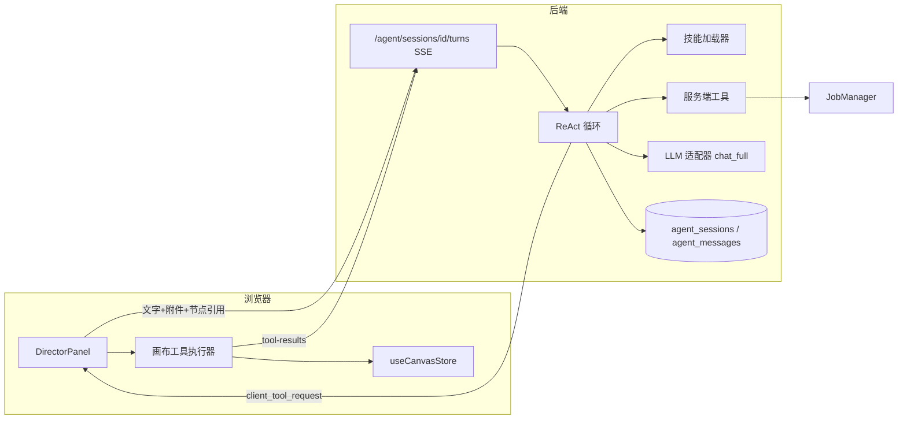

# 画布导演台（Director Agent）架构与开发计划

> 2026-11-01 已按本计划实现。测试用例在 `backend/tests/test_agent.py`，前端构建通过。

## 已确认的决定

- **推理循环用混合模式。** 后端负责会话、调用模型、生成类工具（出图、出视频、读资源）。改画布的工具通过事件下发到浏览器，在现有 zustand store 上执行，执行结果再回传给后端。画布改动进撤销栈；关掉页面后，Agent 停止。
- **技能采用 Agent Skills 标准。** 一个技能是 `SKILL.md` 加上 `references/`、`assets/`，可含 `scripts/`；脚本由安全路由确认后运行。
- **操作权限。** 加节点、改节点、连线、断线自动执行，可以 Ctrl+Z 撤销。删除节点和提交生成任务（占用 GPU）先弹确认卡片。导演技能的每一步另外按你的要求，确认后才进入下一步。
- **参考资料。** OpenClaw 分层 MD 参考 `参考项目/agent`（`AGENTS.md`、`SOUL.md`、`TOOLS.md` 等）和 OpenClaw 指南。`参考项目/工作流参考` 里只有 ComfyUI JSON，不作为 Agent 设计参考。

## 总体架构

一轮对话的流程：
1. 浏览器调用 `POST /api/v1/agent/sessions/{id}/turns`，后端用 SSE 推回事件。事件类型有 `token`、`tool_start` / `tool_progress` / `tool_end`、`client_tool_request`、`ask_user`、`turn_end`。
2. 模型要调用画布工具时，后端发出 `client_tool_request`，并以 `turn_end{status:"awaiting_client"}` 结束本段。
3. 浏览器执行工具（需要确认的先等用户点确认），再调用 `POST .../tool-results`。后端从数据库恢复上下文，开一段新的 SSE 继续循环。
4. 中断用 `POST .../cancel`。每轮最多 25 步，超过就停下来问用户。
5. 浏览器用 `fetch` 加 `ReadableStream` 解析 SSE，因为原生 EventSource 带不上 Authorization 头。后端沿用现有的 sse-starlette。

## 一、后端

### 1. 数据表（Alembic `0007_agent`，`down_revision="0006_canvas"`）

- `agent_sessions`：`id`（uuid）、`owner_id`、`canvas_id`（可空，导演台按画布分会话）、`title`、`provider_id`、`model`、`active_skill`、`skill_state`（JSON，记录导演进行到哪一步和已产出的内容）、`created_at`、`updated_at`。
- `agent_messages`：`id`、`session_id`、`role`（`user` / `assistant` / `tool` / `event`）、`content`（JSON：文本片段、附件资产 id、节点引用、`tool_calls`、工具结果）、`created_at`。
- `agent_skills`：`name`、`source`（`builtin` / `user`）、`enabled`、`version`、`updated_at`。技能正文放在文件里，不进数据库。
- 模型类放在新文件 `backend/liberastra/models/agent.py`，并在 `models/__init__.py` 里登记。

### 2. LLM 适配器：支持工具调用和多模态

现有 `chat()` 只返回字符串，`tool_calls` 会丢掉。

- 在 [backend/liberastra/providers/base.py](backend/liberastra/providers/base.py) 新增 `chat_full(model, messages, tools=None, stream=True)`，返回内容增量和 `tool_calls`。原来的 `chat()` 不动。
- [providers/llm/openai_compatible.py](backend/liberastra/providers/llm/openai_compatible.py)：解析 `choices[0].message.tool_calls`，流式时把 `delta.tool_calls` 累积起来。Ollama 走 `/v1`，复用这一实现。
- [providers/vendors/cloud/anthropic.py](backend/liberastra/providers/vendors/cloud/anthropic.py)：工具定义转成 `input_schema`；`tool_use` / `tool_result` 块双向转换；OpenAI 风格的 `image_url` 转成 Anthropic 的 image 块。
- [providers/vendors/volcengine/ark.py](backend/liberastra/providers/vendors/volcengine/ark.py)：补上流式输出，工具调用按 OpenAI 格式处理。
- **不支持原生工具调用的模型**走文本协议兜底：系统提示要求模型输出 `<tool_call>{"name":...,"arguments":...}</tool_call>`，后端负责解析。

### 3. 模型能力标记（工具调用、视觉）

- 在 [providers/catalog.py](backend/liberastra/providers/catalog.py) 的 `SUB_CAPABILITIES` 里登记 `tools`（工具调用）。`model_profile` 中 LLM 的细分能力改为 `["chat","vision","tools"]`；不登记的话，`normalize_model_item` 会把这个标记过滤掉。
- 在 `presets.py` 里给已知模型标上 `vision` 和 `tools`。远端新拉到的模型默认只有 `chat`，用户可以在服务提供方的模型目录里手动勾选（现有的「视觉」复选框旁边加一个「工具」）。
- 新增 `model_caps(provider, model)`，读 `read_catalog` 返回 `{vision, tools}`，前后端都用它来做校验。

### 4. 消息组装与视觉校验（`backend/liberastra/agent/context.py`）

- **图片附件**：缩到长边 1568px，转成 data URL。mime 用 `mimetypes` 补全，`storage/local.py` 的 mime 表缺 webp、jpeg、webm 等扩展名。
- **视频附件**：用 ffmpeg 均匀抽 4 到 6 帧作为图片，另附一句时长说明。
- **文本、字幕附件**：正文直接放进消息，超过 20k 字截断。
- **音频附件**：不直接送给模型，提示 Agent 可以先调语音转文字工具。
- **节点引用**：转成结构化描述，包括节点种类、varName、配置摘要、产出资产 id、文本产出。被引用节点的图片或视频产出也按上面的规则处理。
- **视觉校验**：消息里带了图片或视频、而模型没有 `vision` 标记时，后端返回 400，错误信息说明原因并建议换模型。前端发送前先拦截一次。

### 5. Agent 运行时（`backend/liberastra/agent/`）

- `runtime.py`：ReAct 循环，处理流式输出、工具调用分发、步数上限和取消。
- `workspace.py`：分层系统提示，按 OpenClaw 的思路组织。
  - 内置文件放在 `agent/workspace/`：`SOUL.md`（身份与风格）、`AGENTS.md`（行为准则、确认规则、先澄清再动手）、`TOOLS.md`（工具说明和降级方式）。
  - 用户可以在 `data/agent/workspace/` 里放同名文件覆盖内置版本，合并方式照搬 `services/prompts.py` 的 `_merged_section`。
  - 长期记忆 `MEMORY.md` 放到后续阶段。
- `skills.py`：技能分步加载。
  - 系统提示里只列出各技能的名称和描述。
  - 模型调用 `load_skill(name)` 拿到正文，调用 `read_skill_file(name, path)` 读 references。
  - 用户在「技能」菜单里点选某个技能时，会话直接固定使用它。
- **工具清单**：

| 归属 | 工具 |
|------|------|
| 服务端 | `ask_user`（结构化提问或确认卡片） |
| 服务端 | `load_skill`、`read_skill_file`、`save_skill` |
| 服务端 | `list_assets`、`get_asset`、`read_asset_text`、`list_characters`、`list_canvas_menu`、`list_workflows`、`list_execution_specs`、`list_voices`、`list_music` |
| 服务端，需确认 | `generate_image`、`edit_image`、`generate_video`、`tts`、`asr`、`create_character`。走现有 Job 系统，等待时推送 `tool_progress` |
| 浏览器 | `canvas_get_graph`、`canvas_get_node`、`canvas_get_node_schema` |
| 浏览器 | `canvas_add_node`、`canvas_update_node`、`canvas_connect`、`canvas_disconnect`、`canvas_set_binding`、`canvas_layout` |
| 浏览器，需确认 | `canvas_delete_nodes`、`canvas_run_nodes` |

- `list_canvas_menu` 返回用户菜单设置里的实际控件、媒体槽、可用工作流和默认工作流；`list_workflows` 返回完整输入参数规格；`canvas_get_node_schema` 返回当前节点的执行目标、输入槽和可编辑参数。调整节点属性前先读这些信息。

- 路由 `backend/liberastra/api/routes/agent.py`：
  - 会话：增、删、查、改名，查看历史消息。
  - 对话：`turns`、`tool-results`、`cancel`。
  - 技能：列表、上传（单个 `SKILL.md` 或 zip）、启用或停用、删除、查看、导出。

### 6. 技能存储与上传校验

- 内置技能：`backend/liberastra/agent/skills/{director,canvas-auto,skill-creator,liberastra,project-info}/`，采用 Agent Skills 标准目录：`SKILL.md` + `references/`、`assets/`，可含 `scripts/`。
- 用户技能：`data/agent/skills/<name>/`。
- 上传时检查：
  - YAML front matter 必须有 `name` 和 `description`；可选 `license`、`compatibility`、`metadata`、`allowed-tools`。
  - `name` 1–64 字，小写字母、数字、连字符，不以连字符开头/结尾，不连续出现连字符。
  - `description` 不超过 1024 字；`compatibility` 不超过 500 字。
  - 文件后缀不设限制，脚本、引用文档、模板和资源都可以打包。
  - 保留资源保护：单文件 8MB、整包 32MB、最多 1000 个文件，拒绝路径穿越。
  - 和内置技能同名时拒绝。
- 风险操作由 `agent/safety.py` 统一路由：只读和可逆画布编辑自动执行；删除、生成、写技能文件、运行脚本默认确认，用户可选择一次执行或本会话自动允许。
- 功能节点先空白创建，再用 `canvas_apply_menu` 套功能菜单（解析到工作流或模型），没有合适菜单才用 `canvas_apply_pack`；禁止直接写 `pack`/`outputKind`。
- `canvas_run_nodes` 只提交当前节点，上游默认复用；确认卡提供「执行当前节点」「强制执行含上游」「本会话自动允许」「取消」，只有显式选择才强制上游。

## 二、前端：导演台界面

### 1. 面板与布局（新目录 `frontend/src/components/director/`）

- `DirectorPanel.tsx` 挂在 [CanvasPage.tsx](frontend/src/pages/CanvasPage.tsx) 的 `wrapRef` 里。
  - 默认停靠画布左侧：从「退出」按钮下方开始，到底部，宽 380px。
  - 顶部标题栏可以拖动，面板在画布范围内自由悬浮。拖动有边界约束，位置存在本机。
- **收起状态**：底部左侧一条窄栏，形态参考你的第二张图，有标题、展开按钮和一个简短的输入框。点输入框或展开按钮都会展开，展开后光标落在输入框里。
- **顶部**：会话下拉，形态参考第一张图，包括会话列表和新建按钮；另有收起按钮。
- **避让**：调整 React Flow 的 `Controls`，避免被面板挡住。右侧 `NodeInspector` 位置不变。

### 2. 消息区

- 回复正文用现有的 `MarkdownView` 渲染。
- 工具调用显示为可展开的卡片，内容包括名称、参数摘要、进度和结果。
- 生成出来的图片、视频直接显示在消息里，点开用现有的 `MediaLightbox`。
- `ask_user` 显示为选项按钮或「确认 / 修改」卡片。
- 删除节点和提交生成的确认卡片上，会列出受影响的节点或预计要跑的任务。

### 3. 输入区

- **附件按钮「+」**：
  - 上传文本、图片或视频，走 `api.uploadFileAsAsset(file, kind, hidden=true)`。
  - 也可以选已有资源。[AssetPicker.tsx](frontend/src/components/canvas/AssetPicker.tsx) 改成支持多选，并加上 text 类型。
- **技能菜单**：列出内置技能和用户技能，可以选定当前技能、上传技能，还有「管理技能」弹窗（启用、停用、删除、查看）。
- **模型选择**：列出 LLM 服务商的模型，有视觉能力的标眼睛图标，支持工具调用的标扳手图标。默认用系统设置里的默认 LLM，你上次选的模型记在本机。
- **视觉校验**：附件或节点引用里有图片、视频，而当前模型没有视觉能力时，禁止发送，并给出两个出路：换模型，或去掉图片只发文字。
- **`/` 节点引用**：
  - 先把 [PromptField.tsx](frontend/src/components/PromptField.tsx) 的斜杠菜单抽成共用 hook `useSlashMenu`，导演台和节点提示词共用：上下键移动，回车填入，Esc 关闭。
  - 列出画布上的全部节点，分三种状态：
    - **可引用产出**：已经有产出资产或文本。
    - **仅引用配置**：还没跑过，或者是还没选功能的功能节点。这类节点用节点 id 生成临时别名，Agent 只能看到它的配置，不附带媒体。
    - **不可引用**：节点已被删除。只显示，选不中，并写明原因。
  - 填进输入框的写法是 `@output_image_1`；没有 varName 的节点写成 `@节点#短id`。发送时浏览器把这些引用解析成 `refs` 一起提交，引用的图片也要过视觉校验。

### 4. 浏览器端画布工具（`frontend/src/director/clientTools.ts`）

需要先整理画布 store 和页面里的几处逻辑：
- 把 `CanvasPage` 内部的 `addFromMenu` 抽成模块级服务函数，传入 `queryClient`。
- 新增 `deleteNodes(ids)`：删除节点时连带删除相连的边。现在删节点不会删边，后端保存时会拒绝。
- `addNode` 增加不改变选中的选项，Agent 批量加节点时不打乱你当前选中的节点。
- 把 `promptVarsFor(nodeId)` 抽成纯函数。
- 预检和执行逻辑抽出来，`canvas_run_nodes` 复用；执行前先保存。
- 每个工具调用都包在 `store.batch()` 里，一次调用算一步撤销。

## 三、新节点：图片合成

导演技能的「分镜关键帧合成一张图」要用到它，归在现有的合成节点一类。

- 前端：
  - [canvas/types.ts](frontend/src/canvas/types.ts) 的 `ConcatMediaKind` 加 `image`。新字段 `layout`（`horizontal` / `vertical` / `grid`）、`columns`、`gap`（默认 4px）、`gapColor`（默认 `#FFFFFF`），并在 `normalizeNodeData` 里保留这些字段。
  - `QuickAddMenu` 加「图片合成」入口。
  - `validation.ts` 和 `preflight.ts` 接受图片来源，至少要 2 路输入。
  - `NodeInspector` 加布局设置。
- 后端：
  - `canvas_run.py` 和 `media_jobs` 增加 image 分支，用 PIL 拼图：横排时统一高度，竖排时统一宽度，网格按最矮图片统一高度并紧排居中；网格行优先，先连的 N 张在第一行。间隔填白色，输出 PNG。
  - 布局参数计入指纹（fingerprint），参数变了才重跑。

## 四、内置技能

1. **导演**（`director`）
   - 按步骤推进，每一步用 `ask_user` 收集信息，并让你确认后再继续。当前步骤和产出写进 `skill_state`，刷新页面后能接着做：
     1. 主题
     2. 角色设计（选角色库里的角色、文生图、图生图，或者新建角色）
     3. 剧本内容
     4. 分镜数量
     5. 分镜提示词
     6. 关键帧生成方式：只生成首帧，或生成首尾帧。选择后自动生成对应的关键帧提示词：首帧模式每镜 1 张，首尾帧模式每镜 2 张。
     7. 生成关键帧图片
     8. 选择视频生成方式：图生视频 / 图生增强，或参考图。
     9. 生成视频
   - 生成分镜图片前先问关键帧方式。当前视频节点只使用首帧，所以选首尾帧时，尾帧只用于参考图合成，不接入图生视频 / 图生增强节点；选首帧时，参考图合成只有一行，第 N 张图对应第 N 个分镜。
   - 分镜提示词模板固定包含这些部分：主题与场景限制；角色图引用和人物一致性说明；镜头说明（场景、内容、景别、光影、镜头语言、人物动作和物理规律、材质、视觉风格与分格）；视频内容约束。
   - 关键帧提示词按模式自动适配：首帧强调开场、动作起点和构图；尾帧强调收束、动作终点和与首帧的衔接。首帧模式不生成尾帧提示词。
   - 每一步通过自动画布工具在画布上搭节点：
     - 角色：输入节点加图像功能节点，或者角色输入节点。
     - 剧本：存进文本输入节点。
     - 关键帧：文生图或图生图节点，引用角色图。
     - 视频：图生视频 / 图生增强节点只用首帧；参考图模式先把多个分镜的首帧（首尾帧模式还包括尾帧）合成参考图，再建参考视频节点。
   - 创建功能节点前先读画布菜单设置：当前有哪些节点、每个节点的可用工作流和默认工作流、目标有几个图片槽。不要写死工作流名。
   - 套用菜单时如果已经有上游，连同 `bindings` 一起传（槽位 → 上游变量名），避免自动补建空输入节点；工具会自动补上游连线。`bindings` 只选槽，媒体依赖必须存在直接连线；返回 `missing_bindings` 时先用 `canvas_connect` 补线。提示词写在功能节点自身，不再自动生成空文本输入。
   - 参考图模式的视频节点 `prompt` 用 `{{input_text_group_<组号>}}` 引用组文本，不要内联复制正文。
   - 参考图合成分组规则：
     - 只生成首帧：一行 N 张，第 N 张对应第 N 个分镜；提示词写明“第几张图对应第几个分镜”。
     - 首尾帧：2 行 N 列，第一行是各分镜首帧，第二行是尾帧；每列上下两张属于同一个分镜；提示词写明“第 i 列对应第 i 个分镜，上方首帧、下方尾帧”。
     - 图片合成时先连该组全部首帧，再连该组全部尾帧（首尾帧模式）；只生成首帧时按分镜顺序连。
   - 提交生成仍然按权限规则先确认。全部生成后不要自动整理画布。
2. **自动画布**（`canvas-auto`）：说明各个画布工具的用法和约定，包括节点种类、varName、绑定（bindings）、`{{var}}` 和 `<Picture N>` 写法、先预检再执行。
3. **技能生成**（`skill-creator`）：参照 ClawHub 上 skill-creator 的思路自己写，不从网上拉取。引导你说清楚技能的用途、触发条件、步骤和示例，生成 `SKILL.md`，你确认后用 `save_skill` 保存。
4. **LiberAstra**（`liberastra`）：不动画布，直接调服务端生成工具，给你出图片、视频、语音，也能把语音转成文字，结果显示在对话里。同时更新仓库里给外部 Agent 用的 [skills/liberastra/SKILL.md](skills/liberastra/SKILL.md)，对齐当前的 CLI 和 MCP 命令。
5. **项目信息**（`project-info`）：只读技能。读取资产、工作流包、角色库、音色库、音乐库、画布菜单设置、每个菜单项的可用工作流和默认工作流，以及当前节点的属性参数。用于在改节点前先确认资源、目标和字段，不直接修改画布。

## 五、开发顺序

1. **后端底座**：数据表和迁移、`chat_full` 工具调用、能力标记、消息组装和视觉校验、运行时与 SSE、技能加载器。
2. **导演台界面**：面板、拖动、收起、会话、消息渲染、附件与资源选择、模型选择、视觉校验、`/` 节点引用。
3. **画布工具**：store 整理、浏览器端工具执行器、确认卡片，以及自动画布技能。
4. **图片合成节点**。
5. **技能**：导演、自动画布、LiberAstra、技能生成、项目信息，再加上技能上传与管理界面。
6. **测试、文档、翻译**：
   - pytest 覆盖：工具调用解析（模拟 httpx）、假模型驱动的完整循环、标准技能包上传、视觉拦截、PIL 拼图。
   - 前端 `npm run build`，再用浏览器在本机验证。验证时不点生成。
   - 更新使用文档的画布章节，`ui-en.ts` 补英文。

## 六、暂定默认值（不合适随时改）

- 长期记忆（`MEMORY.md`、每日日志）放到后续阶段，第一版只保留会话历史；历史过长时自动摘要。
- 导演台默认模型跟随系统设置里的默认 LLM，不单独加系统偏好。
- 图片合成默认横排、间隔 4px、白色；网格按最矮图片统一高度并紧排，避免不同宽高比留下大片空白。导演技能在生成分镜图片前询问只生成首帧还是首尾帧：首帧模式每镜 1 张，首尾帧模式每镜 2 张。
